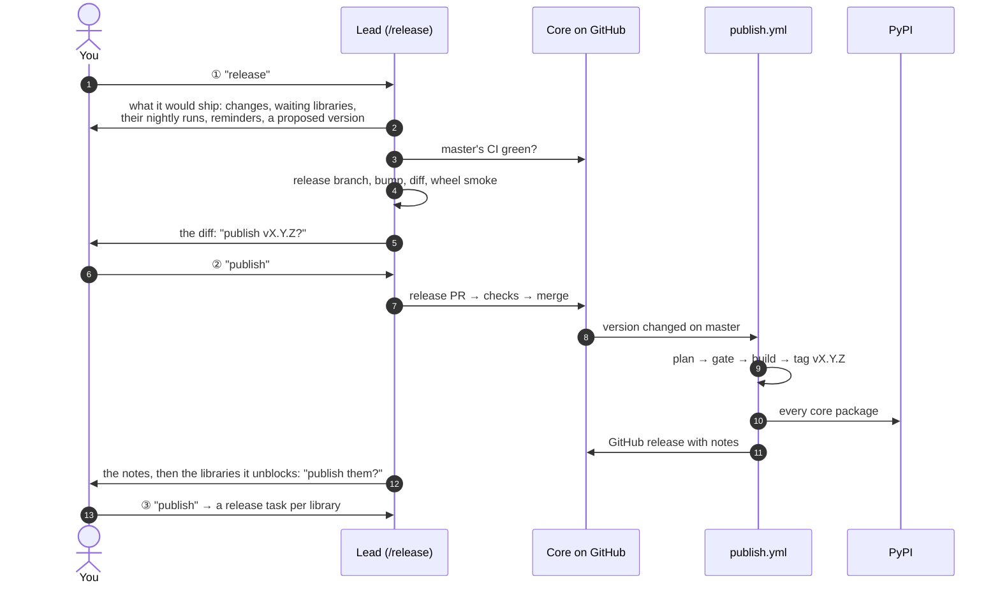

# A core release

**For:** the maintainer and the lead. Core releases are batched: merged changes wait on
`master` until the maintainer starts a release.

| Step | Who | Where the rule or command lives |
|---|---|---|
| ① When to release | maintainer | [ADR 0087](../adr/0087-releases-are-batched-and-a-librarys-dependency-floor-guards-its-release.md) |
| What it would ship, the version proposal | lead | [The release skill](https://github.com/going-haywire/haywire/blob/master/.claude/skills/release/SKILL.md), step 0 |
| Waiting and unblocked libraries | lead | `scripts/release_sweep.py floors` and `nightly`, read by the release skill |
| ② "publish" | maintainer | [The release skill](https://github.com/going-haywire/haywire/blob/master/.claude/skills/release/SKILL.md), step 5 |
| The merge run | CI | [Publishing releases](../reference/publish_releases.md), [ADR 0088](../adr/0088-a-release-is-the-merge-of-a-release-pr-and-ci-tags-it.md) |
| ③ The unblocked libraries | lead asks | [The release skill](https://github.com/going-haywire/haywire/blob/master/.claude/skills/release/SKILL.md), the last step; then [A library release](library-release.md) |
