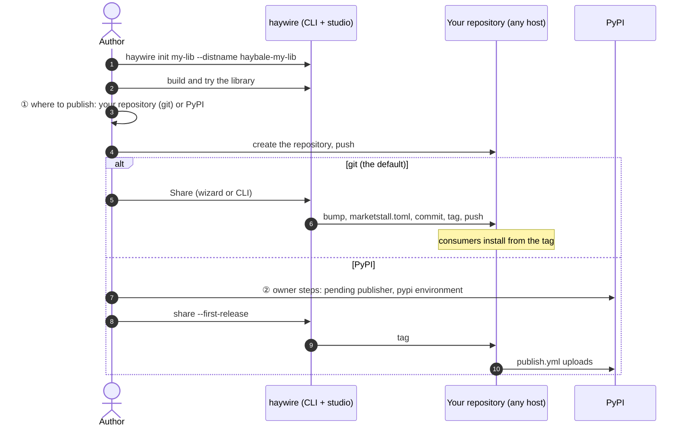

# Create a library and share it the first time

**For:** library authors. **Needs:** git and an account on any host; PyPI is optional
([ADR 0086](../adr/0086-the-simple-path-is-the-floor.md)).

| Step | Who | Where the rule or command lives |
|---|---|---|
| Create the project with its public name | author | [Sharing libraries §1](../guides/sharing-libraries.md#1-the-short-version); without `--distname` the name is `hay-…`, local only: [Rename, then share](rename-then-share.md) |
| Try it in the studio | author | [Sharing libraries §7](../guides/sharing-libraries.md#7-the-full-author-cycle) |
| ① Choose git or PyPI | author | [Publishing to PyPI §5](../guides/publish-to-pypi.md#5-declare-how-you-distribute) |
| A repository and a clean, pushed tree | author | [Sharing libraries §4](../guides/sharing-libraries.md#4-what-has-to-be-true-before-you-publish) |
| Share | author, or their agent through the project's `CLAUDE.md` | [Sharing libraries §2](../guides/sharing-libraries.md#2-publishing) |
| ② The owner steps for PyPI | author (owner) | [Publishing to PyPI §2–§3](../guides/publish-to-pypi.md#2-before-you-start-claim-the-name), [Sharing libraries §2.5](../guides/sharing-libraries.md#25-steps-only-the-owner-can-do) |
| The first PyPI release | author | [Publishing to PyPI §6](../guides/publish-to-pypi.md#6-the-first-release) |

Next: [Share an update](share-an-update.md). Users install it as in
[Subscribe and install](subscribe-and-install.md).
