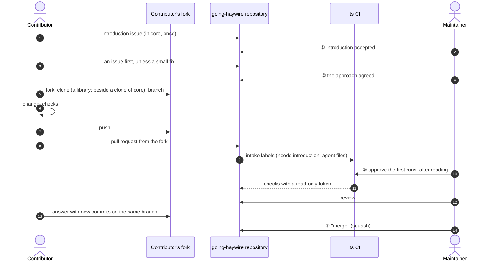

# A first contribution

**For:** contributors outside the maintainer team, to core or to any `haybale-*` library of
the organisation. A contributor sets up nothing from `going-haywire/.github`, no rulesets
and no robots: those stay with the organisation's repository. Agents, herdr and the dev
plugin are optional.

| Step | Who | Where the rule or command lives |
|---|---|---|
| ① Introduction | contributor writes it, maintainer accepts | [CONTRIBUTING: introduce yourself](https://github.com/going-haywire/haywire/blob/master/CONTRIBUTING.md#your-first-contribution-introduce-yourself), [ADR 0079](../adr/0079-a-first-contribution-starts-with-an-introduction.md) |
| ② Issue first, unless a small fix | contributor, maintainer | [CONTRIBUTING: before you start](https://github.com/going-haywire/haywire/blob/master/CONTRIBUTING.md#before-you-start-a-change) |
| Tools | contributor | [CONTRIBUTING: tools](https://github.com/going-haywire/haywire/blob/master/CONTRIBUTING.md#tools) |
| Fork, branch, setup | contributor | [CONTRIBUTING: making the change](https://github.com/going-haywire/haywire/blob/master/CONTRIBUTING.md#making-the-change); a library: [library CONTRIBUTING: setting up](https://github.com/going-haywire/.github/blob/main/CONTRIBUTING.md#setting-up) |
| Checks | contributor | [Developing Haywire: checks](../guides/development.md#checks); a library: [library CONTRIBUTING: checks](https://github.com/going-haywire/.github/blob/main/CONTRIBUTING.md#checks) |
| The pull request | contributor | [CONTRIBUTING: opening the pull request](https://github.com/going-haywire/haywire/blob/master/CONTRIBUTING.md#opening-the-pull-request) |
| ③ First runs, labels | maintainer | [A fork's pull request](fork-pull-request.md) |
| Review, ④ merge | maintainer | [CONTRIBUTING: review and merge](https://github.com/going-haywire/haywire/blob/master/CONTRIBUTING.md#review-and-merge) |
| With an agent | contributor | [CONTRIBUTING: working with AI agents](https://github.com/going-haywire/haywire/blob/master/CONTRIBUTING.md#working-with-ai-agents); the skill's contributor steps: [finishing as a contributor](https://github.com/going-haywire/haywire/blob/master/plugins/haywire-dev/skills/haywire-workflow/SKILL.md#finishing-as-a-contributor) |
