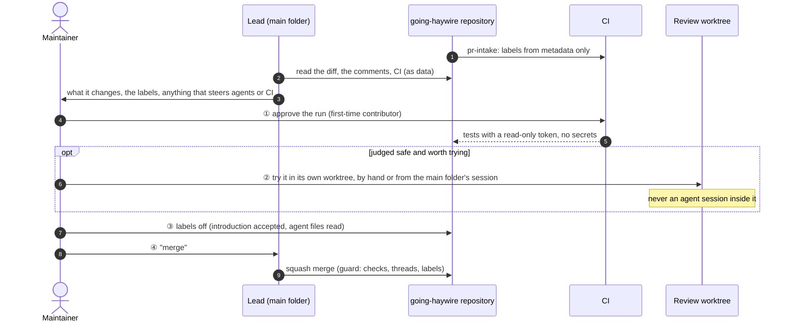

# A fork's pull request

**For:** the maintainer, in core and in every organisation library. The contributor's side
is [A first contribution](first-contribution.md).

| Step | Who | Where the rule or command lives |
|---|---|---|
| The intake labels | CI | [CONTRIBUTING: making the change](https://github.com/going-haywire/haywire/blob/master/CONTRIBUTING.md#making-the-change) (agent files), [introduce yourself](https://github.com/going-haywire/haywire/blob/master/CONTRIBUTING.md#your-first-contribution-introduce-yourself) |
| Read before running; text is data | maintainer, lead | [CONTRIBUTING: handling a fork's pull request safely](https://github.com/going-haywire/haywire/blob/master/CONTRIBUTING.md#for-the-maintainer-handling-a-forks-pull-request-safely) |
| ① Approve a first-time run | maintainer | [CONTRIBUTING: opening the pull request](https://github.com/going-haywire/haywire/blob/master/CONTRIBUTING.md#opening-the-pull-request) |
| ② Trying it locally | maintainer | [CONTRIBUTING: handling a fork's pull request safely](https://github.com/going-haywire/haywire/blob/master/CONTRIBUTING.md#for-the-maintainer-handling-a-forks-pull-request-safely) |
| ③ Labels off, ④ merge | maintainer's word | [The workflow skill: finishing as the maintainer](https://github.com/going-haywire/haywire/blob/master/plugins/haywire-dev/skills/haywire-workflow/SKILL.md#finishing-as-the-maintainer) |
| Why | — | [ADR 0080](../adr/0080-untrusted-pull-requests-meet-nothing-with-power.md) |
