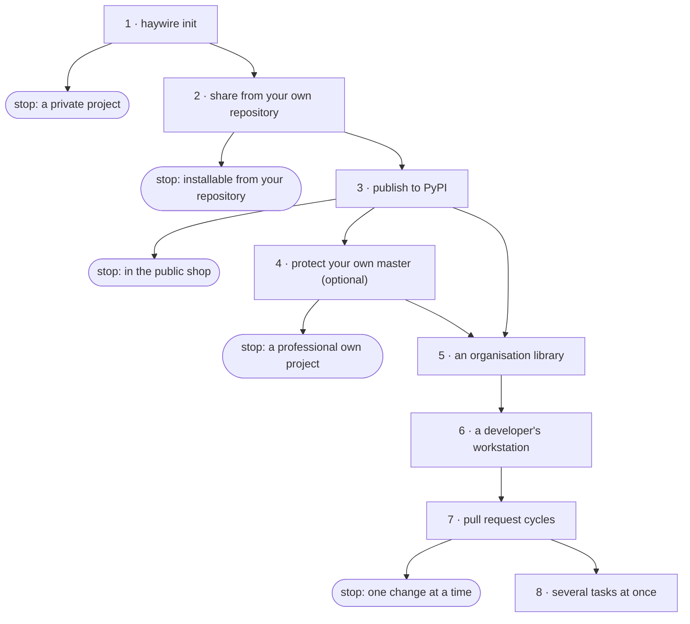

# Collaboration

How work moves in haywire, from a first project on one computer to a library of the
going-haywire organisation that several agents work on at once. Each process has a page
with a sequence diagram (one lane per actor, your decisions numbered ①②③) and a step
table whose every row links to the place that holds that step's rule or command. The
pages draw; they restate no rule.

New to branches, pull requests and CI? Start with [Basics](basics.md).

## The journey

Each stage is useful on its own; nobody has to go further than they want.

| Stage | What happens | Pages |
|---|---|---|
| 1 · Start a project | `haywire init` creates a project with one library, agent instructions and a dormant publishing workflow | [Create and first share](create-and-share.md) |
| 2 · Share from your repository | A public `haybale-` name, a repository on any host, then Share; others install from your repository's tag | [Create and first share](create-and-share.md), [Share an update](share-an-update.md), [Rename, then share](rename-then-share.md) |
| 3 · Publish to PyPI | One-time owner steps on PyPI, then every share uploads through the generated workflow | [Create and first share](create-and-share.md) |
| 4 · Protect your own master | Optional guidance: releases go through a release pull request | [Share an update](share-an-update.md) |
| 5 · An organisation library | The repository joins going-haywire: shared CI, rulesets, the agents' dev plugin, development against core's `master` | [A new org library](new-org-library.md) |
| 6 · A workstation | Core and the libraries you work on side by side; the umbrella for several at once | [A developer's workstation](workstation.md) |
| 7 · Pull request cycles | Every change through a pull request, CI, your "merge"; releases on your "publish" | [A task with its live check](task-with-live-check.md), [A change across core and a library](core-and-library-change.md), [A core release](core-release.md), [A library release](library-release.md) |
| 8 · Several tasks at once | A lead session and one session per task, each in its own worktree | [Lead and tasks](lead-and-tasks.md) |

Users install libraries without any of this: [Subscribe and install](subscribe-and-install.md).
Outside contributors propose changes from a fork: [A first contribution](first-contribution.md),
and the maintainer's side of it, [A fork's pull request](fork-pull-request.md).

## By reader

| Reader | Pages |
|---|---|
| Users | [Subscribe and install](subscribe-and-install.md) |
| Library authors | [Create and first share](create-and-share.md), [Share an update](share-an-update.md), [Rename, then share](rename-then-share.md) |
| Contributors | [A first contribution](first-contribution.md) |
| Maintainers | [A task with its live check](task-with-live-check.md), [A fork's pull request](fork-pull-request.md), [A change across core and a library](core-and-library-change.md), [A core release](core-release.md), [A library release](library-release.md), [Lead and tasks](lead-and-tasks.md), [A new org library](new-org-library.md), [A developer's workstation](workstation.md) |

## Two words decide

Every change reaches `master` on the maintainer's **"merge"**, and every release on their
**"publish"**: an agent never merges a release pull request on "merge". Why releases are
a decision of their own: [ADR 0087](../adr/0087-releases-are-batched-and-a-librarys-dependency-floor-guards-its-release.md)
and [ADR 0088](../adr/0088-a-release-is-the-merge-of-a-release-pr-and-ci-tags-it.md).

## Where the rules live

| Place | Read by | The one home for |
|---|---|---|
| This documentation site | users, authors, contributors, maintainers | how haywire works and how to use it; these pages |
| [Glossary](../reference/glossary.md) | everyone | what each haywire term means |
| [Developing Haywire](../guides/development.md) | contributors, agents | every command: setup, checks, tests, builds |
| [Contributing](contributing.md) | contributors, maintainers, agents | the process and its rules |
| [going-haywire/.github README](https://github.com/going-haywire/.github#readme) | maintainers | the shared workflows, rulesets and plugin catalogue |
| `CLAUDE.md` (read through `AGENTS.md`) | agents | what applies to agents only |
| [The workflow](workflow.md) | agents | the step-by-step of every git and pull request action |
| [Decision records](../adr/0086-the-simple-path-is-the-floor.md) | maintainers, agents | why a decision was taken |
| `.insights/` | agents, maintainers | silent traps already known |
