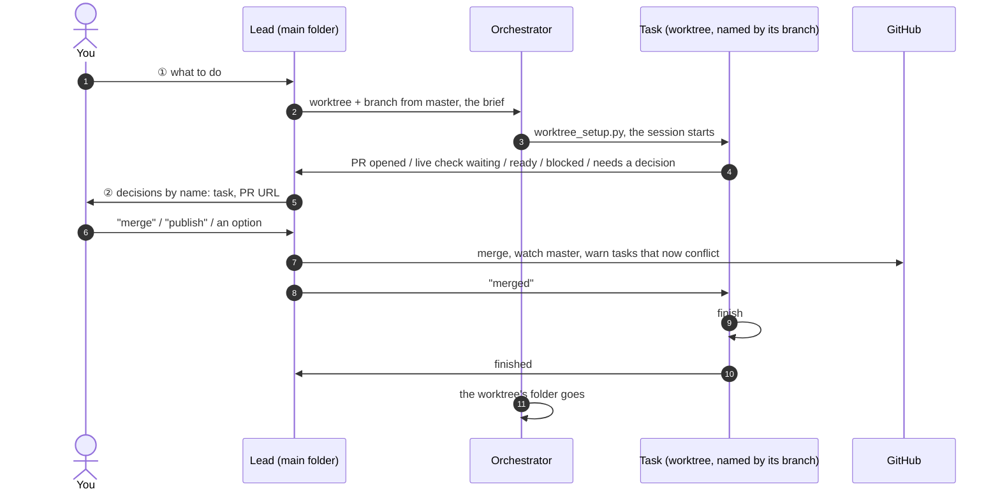

# Lead and tasks

**For:** the maintainer running several tasks at once. Without a lead, the maintainer is
the lead and each task session does the lead's part itself. An
[orchestrator](orchestrators/index.md) runs the sessions and carries their messages; any
will do, or none (then you open the sessions and pass the messages on). Each orchestrator
only translates the four task events below to the same neutral scripts and rules.

| Step | Who | Where the rule or command lives |
|---|---|---|
| ① Start a task (event *created*); reports and names (event *message the lead*) | lead, task | [The workflow: lead and tasks](workflow.md#lead-and-tasks), [the brief](brief.md), `worktree_setup.py --lead`, the [orchestrator's page](orchestrators/index.md) |
| Worktrees and their rules | lead, task | [The workflow: parallel sessions](workflow.md#parallel-sessions) |
| ② Decisions | you | [The workflow: asking the user for a decision](workflow.md#asking-the-user-for-a-decision) |
| Merge, watch master, finish (event *merged*) | lead, task | [The workflow: finishing as the maintainer](workflow.md#finishing-as-the-maintainer) |
| The task view (event *viewed*) | lead | `tasks.py` in core's `dev/scripts/` |
| The tool itself | you | [Orchestrators](orchestrators/index.md) |
