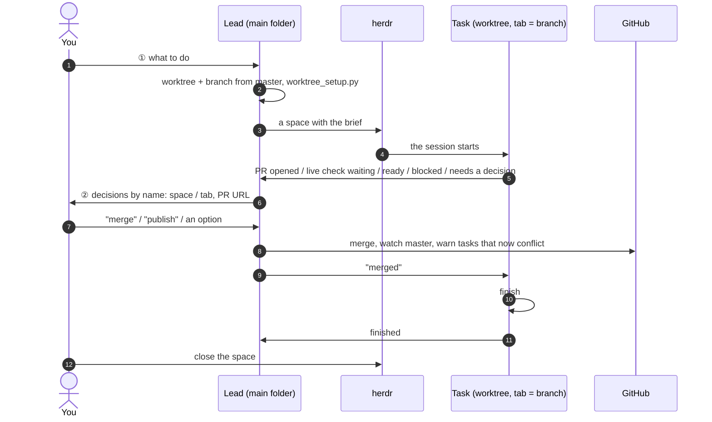

# Lead and tasks

!!! note "Provisional"
    This page draws the lead layer as it runs today, on herdr with `hc`. A trial of
    firstmate as the lead layer may change it.

**For:** the maintainer running several tasks at once. Without a lead, the maintainer is
the lead and each task session does the lead's part itself.

| Step | Who | Where the rule or command lives |
|---|---|---|
| ① Start a task | lead | [The workflow skill: lead and tasks](https://github.com/going-haywire/haywire/blob/master/plugins/haywire-dev/skills/haywire-workflow/SKILL.md#lead-and-tasks) |
| Worktrees and their rules | lead, task | [The workflow skill: parallel sessions](https://github.com/going-haywire/haywire/blob/master/plugins/haywire-dev/skills/haywire-workflow/SKILL.md#parallel-sessions) |
| Reports, names, `hc send` | task, lead | [The workflow skill: lead and tasks](https://github.com/going-haywire/haywire/blob/master/plugins/haywire-dev/skills/haywire-workflow/SKILL.md#lead-and-tasks) |
| ② Decisions | you | [The workflow skill: asking the user for a decision](https://github.com/going-haywire/haywire/blob/master/plugins/haywire-dev/skills/haywire-workflow/SKILL.md#asking-the-user-for-a-decision) |
| Merge, watch master, finish | lead, task | [The workflow skill: finishing as the maintainer](https://github.com/going-haywire/haywire/blob/master/plugins/haywire-dev/skills/haywire-workflow/SKILL.md#finishing-as-the-maintainer) |
| The task view | lead | `tasks.py` in the workflow skill's folder |
