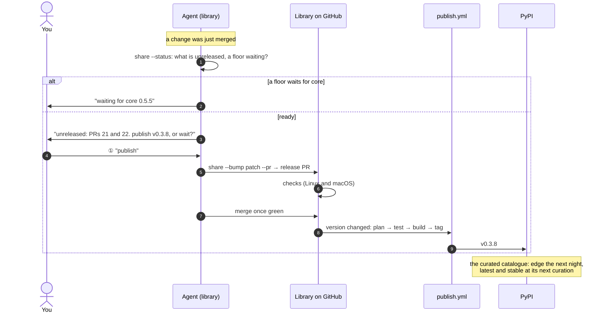

# A library release

**For:** the maintainer and the agents in an organisation library. After each merged
change the agent asks whether to publish; a library usually releases one change at a time.

| Step | Who | Where the rule or command lives |
|---|---|---|
| Ask after a merge | agent | [The workflow skill: in a library repository](https://github.com/going-haywire/haywire/blob/master/plugins/haywire-dev/skills/haywire-workflow/SKILL.md#in-a-library-repository) |
| `share --status` and its states | agent | the library's `CLAUDE.md` (generated by `haywire init`), [Sharing libraries §2.3](../guides/sharing-libraries.md#23-running-it-twice-is-safe) |
| ① "publish", the release PR | maintainer's word | [Sharing libraries §7.2](../guides/sharing-libraries.md#72-releasing-through-a-pull-request-advanced) |
| The merge run | CI | [Publishing to PyPI §4](../guides/publish-to-pypi.md#4-the-workflow) |
| The catalogue picks it up | marketplace | [Curated marketplace §9](../haybale/marketplace/curated-marketplace.md#9-submission-review-removal) |
