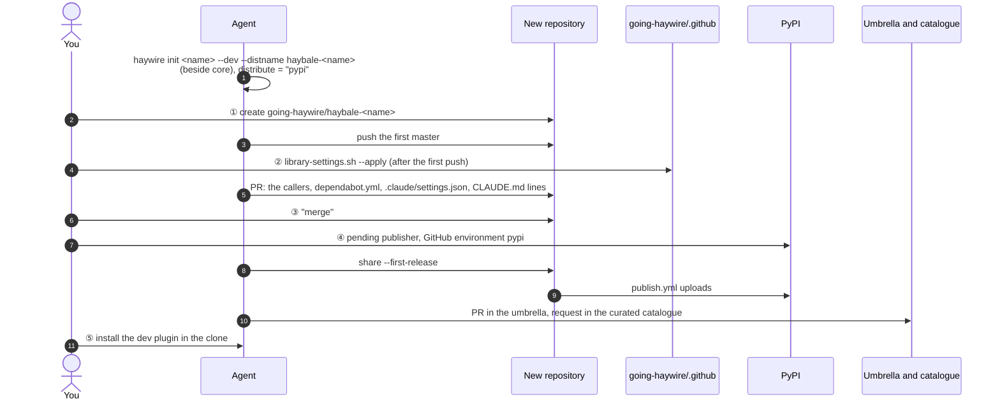

# A new organisation library

**For:** the maintainer. An organisation library follows core's process
([ADR 0086](../adr/0086-the-simple-path-is-the-floor.md), principle 4): pull requests, CI
against core's `master`, protected `master`, releases through release PRs, PyPI.

The order of steps 3 and 4 matters: the *PR gate* ruleset refuses any direct push to
`master`, the first one included.

**Moving an existing project** into the organisation follows the same steps after three
of its own: rename a `hay-` library ([Rename, then share](rename-then-share.md)); transfer
the repository on GitHub (old links keep working); add the PyPI trusted publisher for the
new owner. Its `[tool.uv.sources]` gains the paths to `../haywire-repo` by hand, as
`haywire init --dev` writes them for a new project.

| Step | Who | Where the rule or command lives |
|---|---|---|
| Scaffold with development paths | agent | [Developing Haywire: scaffold a project against your clone](../guides/development.md#scaffold-a-project-against-your-clone), [ADR 0081](../adr/0081-libraries-from-other-repositories-run-from-an-umbrella-environment.md) |
| Publish to PyPI (path sources need it) | — | [Sharing libraries §4.3](../guides/sharing-libraries.md#43-no-path-sources-outside-the-repository) |
| ② Settings, rulesets, labels | maintainer | [going-haywire/.github: a library repository's settings](https://github.com/going-haywire/.github#a-library-repositorys-settings) |
| The callers and their pins | agent | [going-haywire/.github: calling a reusable workflow](https://github.com/going-haywire/.github#calling-a-reusable-workflow) |
| The dev plugin | agent, maintainer | [haywire-dev README](https://github.com/going-haywire/haywire/blob/master/plugins/haywire-dev/README.md) |
| ④ The owner steps for PyPI, the first release | maintainer, agent | [Publishing to PyPI §2–§6](../guides/publish-to-pypi.md#2-before-you-start-claim-the-name) |
| The umbrella | agent | [going-haywire/umbrella](https://github.com/going-haywire/umbrella#readme) |
| The curated catalogue | agent | [Curated marketplace §9](../haybale/marketplace/curated-marketplace.md#9-submission-review-removal) |
| Core's release view sees it | — | `release_sweep.py` lists every `haybale-*` repository by itself |
