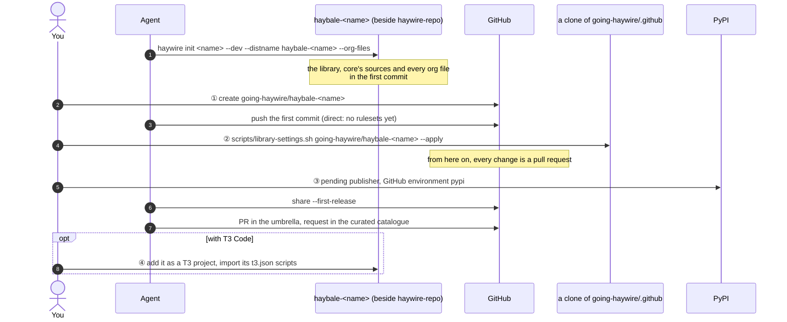

# A new organisation library

**For:** the maintainer, with an agent. An organisation library follows core's process
([ADR 0086](../adr/0086-the-simple-path-is-the-floor.md), principle 4): pull requests, CI
against core's `master`, a protected default branch, releases through release PRs, PyPI.
Setting up its repository takes one command for the files and one script for GitHub; after
that, every clone and every worktree of it works with nothing to install.

**The files** come from one command, `haywire init --org-files` (with a name: into the new
project's first commit). It writes the library's agent files from core (the harness configs with core's
hooks, `t3.json`, `[tool.haywire.agents]`, the `.gitignore` lines, `CLAUDE.md`'s block) and its CI
callers and `dependabot.yml` from `going-haywire/.github`'s workflow templates, pinned to that
repository's current commit. With a name it also writes what that CI runs, so the first commit passes it: the `dev`
dependency group (ruff, pytest), the pytest configuration, `tests/` with a test that the library
loads, and `uv.lock`. What lives where:
[agent tooling](agent-tooling.md#an-org-library-going-haywirehaybale-name).

**The order of ① and ②** matters: the *PR gate* ruleset refuses any direct push to the default
branch, so the first commit goes in before it, and the rulesets need that branch to exist.

**Moving an existing library** into the organisation: rename a `hay-` library
([Rename, then share](rename-then-share.md)); transfer the repository on GitHub (old links keep
working); add the PyPI trusted publisher for the new owner. Its `[tool.uv.sources]` gains the paths
to `../haywire-repo` by hand, as `haywire init --dev` writes them for a new project. Then, in the
library, `uv run haywire init --org-files` writes its files: commit them directly if the repository
has no rulesets yet, otherwise through a pull request; then ② and ③ as above.

**Refreshing** a library's files after core changed them is the same command in the library, through
a pull request. It rewrites the agent files and leaves the CI files alone: once there, they are the
library's own, and Dependabot moves their pins.

| Step | Who | Where the rule or command lives |
|---|---|---|
| Scaffold with development paths and the org files | agent | [Developing Haywire: scaffold a project against your clone](../guides/development.md#scaffold-a-project-against-your-clone), `haywire init --help` |
| Publish to PyPI (path sources need it) | — | [Sharing libraries §4.3](../guides/sharing-libraries.md#43-no-path-sources-outside-the-repository) |
| ② Settings, rulesets, labels | maintainer | [going-haywire/.github: a library repository's settings](https://github.com/going-haywire/.github#a-library-repositorys-settings) |
| The CI callers and their pins | — | [going-haywire/.github: calling a reusable workflow](https://github.com/going-haywire/.github#calling-a-reusable-workflow) |
| ③ The owner steps for PyPI, the first release | maintainer, agent | [Publishing to PyPI §2–§6](../guides/publish-to-pypi.md#2-before-you-start-claim-the-name) |
| The umbrella | agent | [going-haywire/umbrella](https://github.com/going-haywire/umbrella#readme) |
| The curated catalogue | agent | [Curated marketplace §9](../haybale/marketplace/curated-marketplace.md#9-submission-review-removal) |
| Core's release view sees it | — | `release_sweep.py` lists every `haybale-*` repository by itself |
| A developer's clone of it | each developer | [setting someone up](../agents/start.md), *Develop Haywire* |
| ④ T3 Code, if it is your orchestrator | each developer | [T3 Code: once per repository](orchestrators/t3.md#once-per-repository) |
