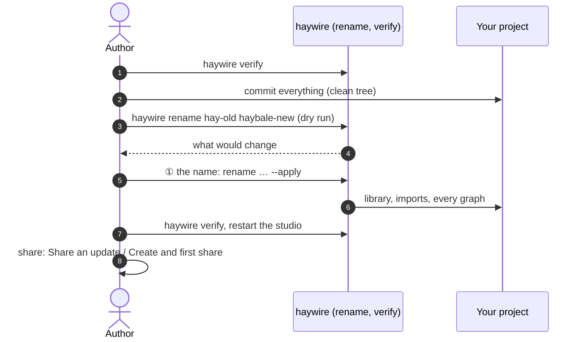

# Rename, then share

**For:** library authors, most often moving a library off the local-only `hay-` name
before its first share.

| Step | Who | Where the rule or command lives |
|---|---|---|
| No graphs yet: create the project again instead | author | [Renaming §1](../guides/rename-library.md#1-the-short-version) |
| Verify and commit | author | [Renaming §4](../guides/rename-library.md#4-what-has-to-be-true-before-you-rename) |
| Dry run | author | [Renaming §5.1](../guides/rename-library.md#51-dry-run-the-default) |
| ① Choose the name and apply | author | [Renaming §3](../guides/rename-library.md#3-choosing-a-name), [§5.2](../guides/rename-library.md#52-applying-it) |
| Confirm, restart | author | [Renaming §5.3](../guides/rename-library.md#53-confirming-the-result) |
| Share | author | [Share an update](share-an-update.md) |
