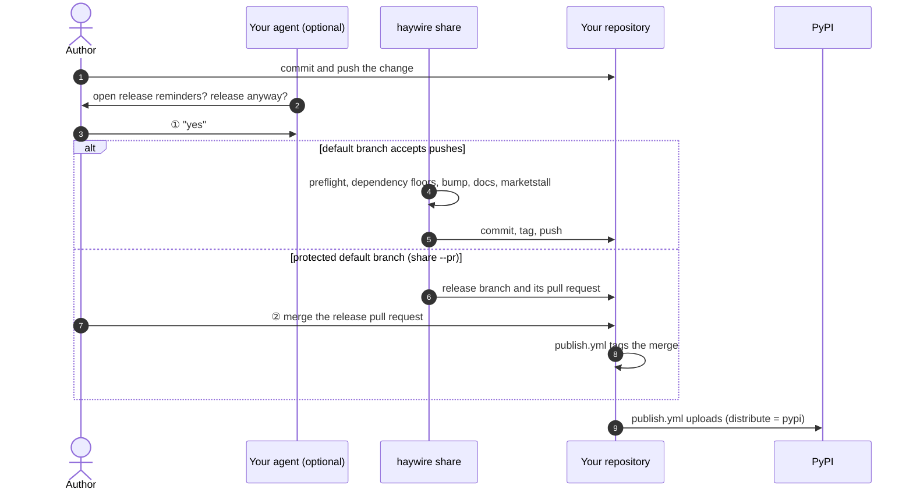

# Share an update

**For:** library authors whose library is already shared once
([Create and first share](create-and-share.md)).

| Step | Who | Where the rule or command lives |
|---|---|---|
| Commit and push | author | [Sharing libraries §4.1](../guides/sharing-libraries.md#41-git-requirements) |
| ① Release reminders | the author's agent proposes, the author decides | [Sharing libraries §7.1](../guides/sharing-libraries.md#71-release-reminders) |
| Share | author or agent | [Sharing libraries §2](../guides/sharing-libraries.md#2-publishing); the agent acts on `share --status` through the project's `CLAUDE.md` |
| A dependency floor no PyPI release satisfies stops the share | `share` | [Sharing libraries §4.4](../guides/sharing-libraries.md#44-dependency-floors-must-exist-on-pypi) |
| ② Through a release pull request | author | [Sharing libraries §7.2](../guides/sharing-libraries.md#72-releasing-through-a-pull-request-advanced) |
| The upload | `publish.yml` | [Publishing to PyPI §4](../guides/publish-to-pypi.md#4-the-workflow) |

!!! note "A project created by an older haywire"
    The publishing workflow comes from `haywire init` and does not update itself. A project
    created before the release-PR mode copies `.github/workflows/publish.yml` and
    `.github/publish_plan.py` from a fresh `haywire init`
    ([Sharing libraries §7.2](../guides/sharing-libraries.md#72-releasing-through-a-pull-request-advanced)).
