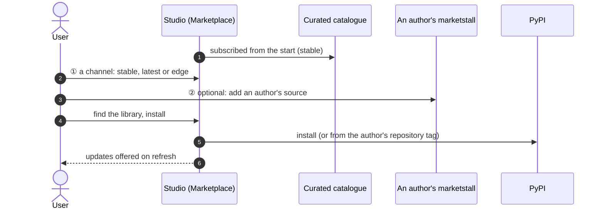

# Subscribe and install

**For:** users of the studio. None of the other pages is needed to install a library.

| Step | Who | Where the rule or command lives |
|---|---|---|
| What you already subscribe to | user | [Subscribing §1.0](../guides/subscribing-to-marketplaces.md#10-what-you-already-subscribe-to) |
| ① A channel, exactly one | user | [Subscribing, Channels](../guides/subscribing-to-marketplaces.md#channels), [Curated marketplace §4](../haybale/marketplace/curated-marketplace.md#4-the-three-channels) |
| ② Add a source | user | [Subscribing §1.1](../guides/subscribing-to-marketplaces.md#11-add-a-source) |
| Find and install | user | [Subscribing §1.2–§1.3](../guides/subscribing-to-marketplaces.md#12-find-the-library) |
| Keeping up to date | user | [Subscribing §1.4](../guides/subscribing-to-marketplaces.md#14-keeping-up-to-date) |

Being listed in the curated catalogue is not a security review: nobody reads the source
([Curated marketplace §9](../haybale/marketplace/curated-marketplace.md#9-submission-review-removal)).
