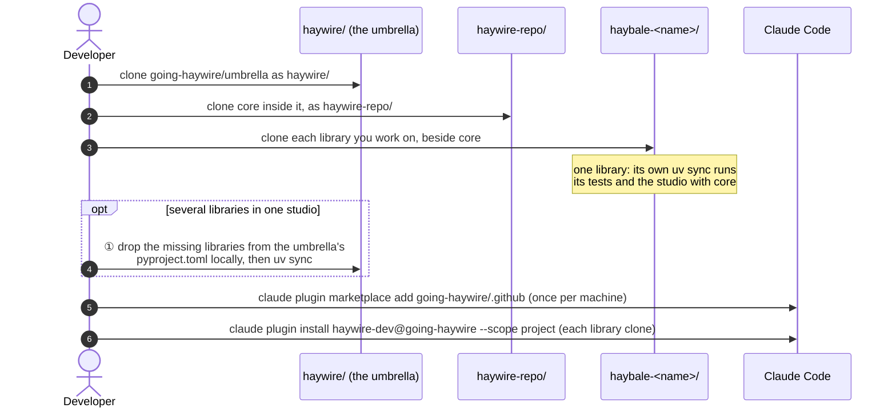

# A developer's workstation

**For:** maintainers and contributors who work on more than one repository. Working on
core alone needs only core ([Developing Haywire: setup](../guides/development.md#setup)).

| Step | Who | Where the rule or command lives |
|---|---|---|
| The layout and the umbrella | developer | [going-haywire/umbrella](https://github.com/going-haywire/umbrella#readme), [ADR 0081](../adr/0081-libraries-from-other-repositories-run-from-an-umbrella-environment.md) |
| One library | developer | [Library CONTRIBUTING: setting up](https://github.com/going-haywire/.github/blob/main/CONTRIBUTING.md#setting-up) |
| ① Only some libraries | developer | ADR 0081, consequences: a missing repository is dropped from the umbrella's `pyproject.toml` locally |
| The dev plugin | developer | [haywire-dev README](https://github.com/going-haywire/haywire/blob/master/plugins/haywire-dev/README.md) |
| Worktrees: core's and a library's | developer, lead | [The workflow skill: parallel sessions](https://github.com/going-haywire/haywire/blob/master/plugins/haywire-dev/skills/haywire-workflow/SKILL.md#parallel-sessions) |
| A second machine | developer | [second-machine.md](https://github.com/going-haywire/haywire/blob/master/plugins/haywire-dev/skills/haywire-workflow/second-machine.md) |
