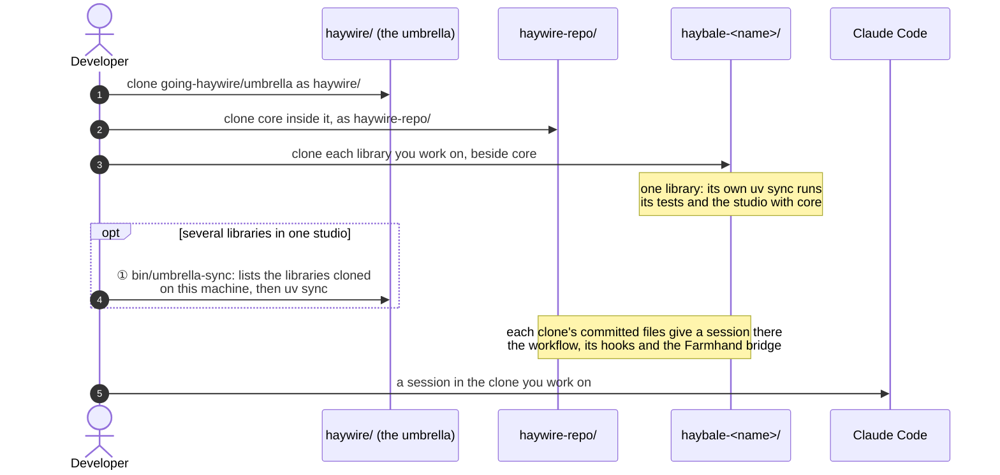

# A developer's workstation

**For:** maintainers and contributors who work on more than one repository. Working on
core alone needs only core ([Developing Haywire: setup](../guides/development.md#setup)).

An agent can do all of this for you: the [start page](../agents/start.md) is written for it.

| Step | Who | Where the rule or command lives |
|---|---|---|
| The layout and the umbrella | developer | [going-haywire/umbrella](https://github.com/going-haywire/umbrella#readme), [ADR 0081](../adr/0081-libraries-from-other-repositories-run-from-an-umbrella-environment.md) |
| One library | developer | [Contributing: in a library](contributing.md#in-a-library) |
| ① Only some libraries | developer | [umbrella README](https://github.com/going-haywire/umbrella#readme): `bin/umbrella-sync` writes the untracked `pyproject.toml` and `uv.lock` from the repositories cloned on this machine |
| The developer tooling | developer | [dev/README](https://github.com/going-haywire/haywire/blob/master/dev/README.md) |
| Worktrees: core's and a library's | developer, lead | [The workflow: parallel sessions](workflow.md#parallel-sessions) |
| A second machine | developer | [second-machine.md](second-machine.md) |
