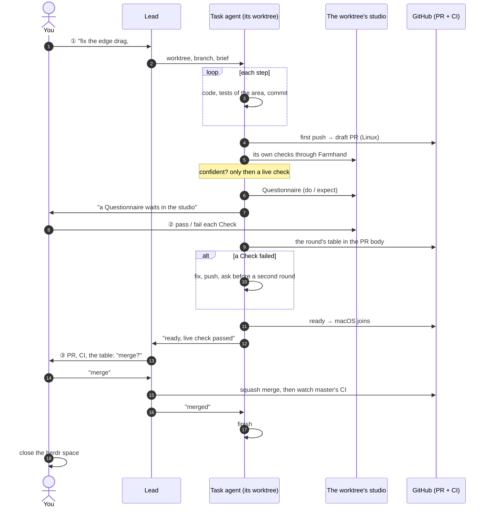

# A task with its live check

**For:** the maintainer and their agents, in core or a library. A live check is only for a
change only a person can judge (UI, interaction, a device).

In a library the task then asks whether to publish: [A library release](library-release.md).
In core, merged changes wait for [A core release](core-release.md).

| Step | Who | Where the rule or command lives |
|---|---|---|
| ① Start the task | lead | [The workflow skill: lead and tasks](https://github.com/going-haywire/haywire/blob/master/plugins/haywire-dev/skills/haywire-workflow/SKILL.md#lead-and-tasks), [parallel sessions](https://github.com/going-haywire/haywire/blob/master/plugins/haywire-dev/skills/haywire-workflow/SKILL.md#parallel-sessions) |
| Code, tests, commits | task | [Choosing and running tests](https://github.com/going-haywire/haywire/blob/master/plugins/haywire-dev/skills/haywire-workflow/SKILL.md#choosing-and-running-tests), [committing](https://github.com/going-haywire/haywire/blob/master/plugins/haywire-dev/skills/haywire-workflow/SKILL.md#committing), [Developing Haywire: checks](../guides/development.md#checks) |
| Draft PR | task | [Pushing and opening the PR](https://github.com/going-haywire/haywire/blob/master/plugins/haywire-dev/skills/haywire-workflow/SKILL.md#pushing-and-opening-the-pr) |
| ② The live check | task asks, you answer | [Live check](https://github.com/going-haywire/haywire/blob/master/plugins/haywire-dev/skills/haywire-workflow/SKILL.md#live-check), [Questionnaire](../reference/questionnaire.md) |
| Ready, ③ merge | lead on your word | [Finishing as the maintainer](https://github.com/going-haywire/haywire/blob/master/plugins/haywire-dev/skills/haywire-workflow/SKILL.md#finishing-as-the-maintainer) |
| Watch master | lead | [Finishing as the maintainer](https://github.com/going-haywire/haywire/blob/master/plugins/haywire-dev/skills/haywire-workflow/SKILL.md#finishing-as-the-maintainer), step 4 |
| Finish | task | [Finishing as the maintainer](https://github.com/going-haywire/haywire/blob/master/plugins/haywire-dev/skills/haywire-workflow/SKILL.md#finishing-as-the-maintainer), step 5; [ADR 0089](../adr/0089-permanent-refs-have-no-bypass-and-agents-clean-up-only-through-finish.md) |
