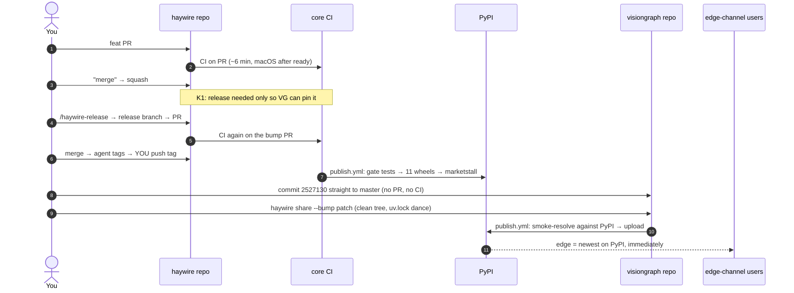
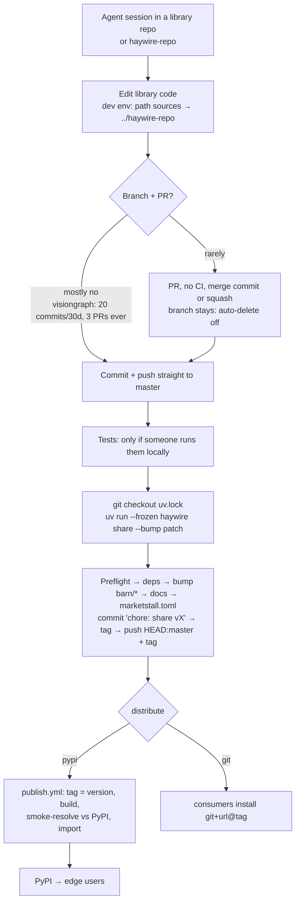
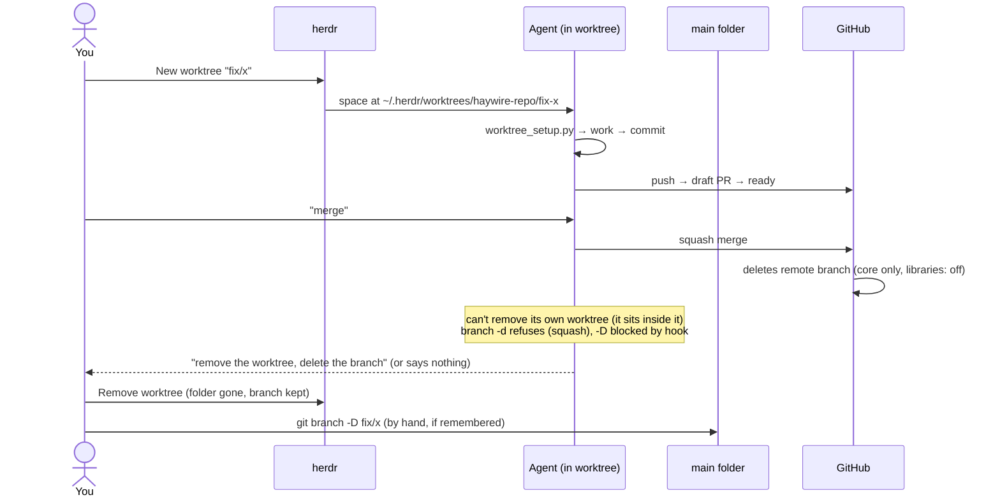
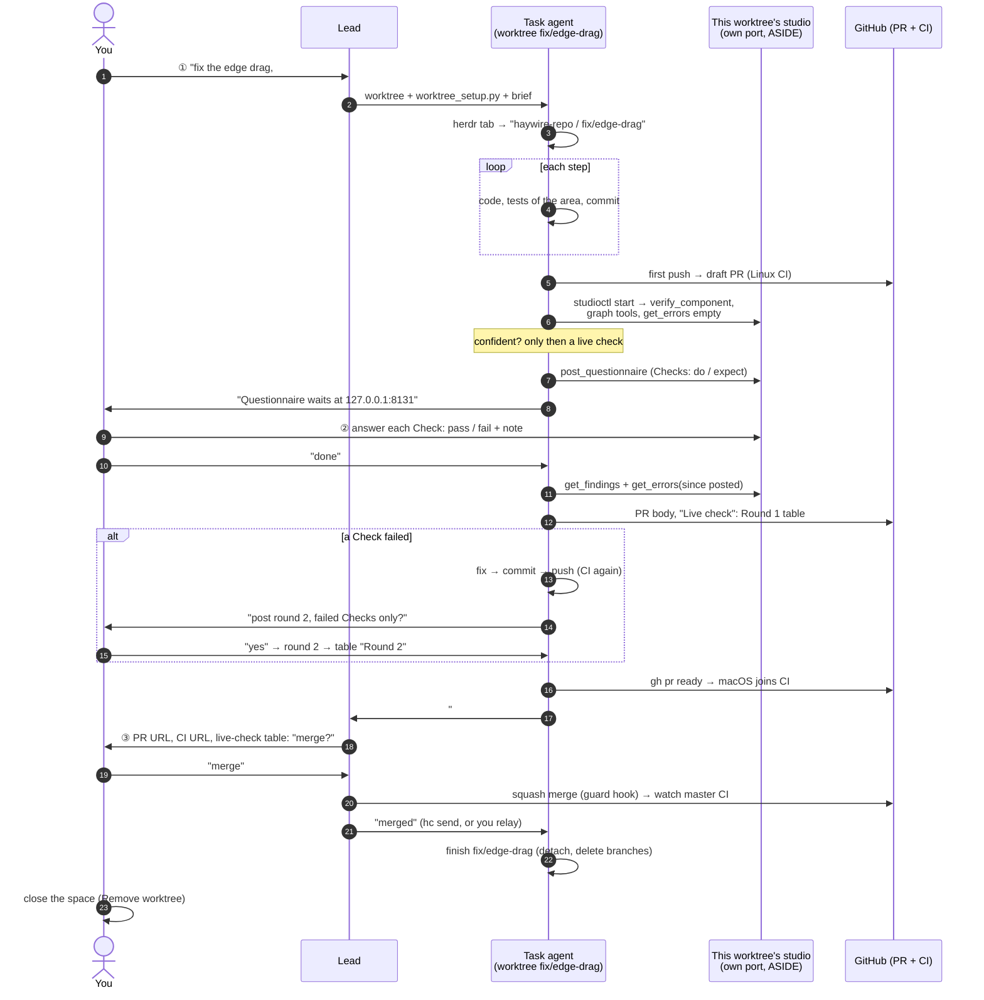
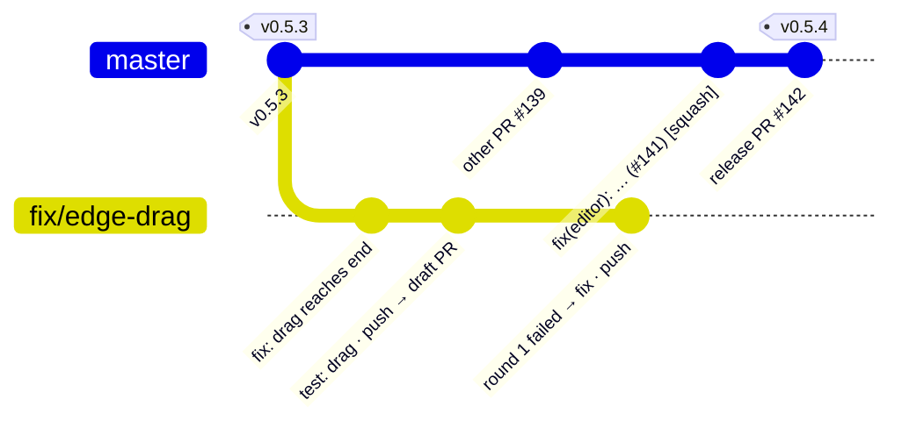

# Release and development workflow review: design and slices

Settled with the user in an inquisition on 2026-11-16 (questions Q1–Q26 below). Each
slice's last task marks its row in *Status* done, with commit, date and deviations.

## Starting a session on this plan

1. One branch, one PR per slice. This plan's own branch is `docs/workflow-review`
   (worktree `~/.herdr/worktrees/haywire-repo/docs-workflow-review`, studio port 8125);
   it also takes S1. Every later slice starts its own task (worktree, `kind/name` branch).
2. Load the `haywire-workflow` skill before any git command (a hook refuses otherwise).
3. Read *Principles*, *Vocabulary* and *Decisions*, then the slice, then the files the
   slice names. *Evidence* holds the facts the decisions rest on, as of 2026-11-16:
   check a number again before relying on it.
4. **(user)** marks a step that needs the user's hands or word: GitHub settings, new
   repositories, labels, anything posted under their name, every merge.
5. Order: S1 → S2 → S3 → S4 → S5 → S6 → S8. S7's framework (mkdocs, index, the pages of
   workflows this plan does not change) may start any time after S1; each other slice
   updates its own workflow page when it lands.
6. Open design points (*D1–D5*) are decided in the slice that names them, with the user,
   in the usual lettered-options form.

## Problem

1. **A small core change a library needs costs two full releases.** View Image's config
   row (#133) needed core v0.5.3 before visiongraph could ship v0.0.45 (15–16 Nov). Core
   cut 11 releases in 10 days, 4 of them on 15 Nov.
2. **Library repositories have no process** while third-party PRs are coming: commits go
   straight to master, no CI runs before publishing, nothing on GitHub protects master.
3. **Agents in herdr cannot see or reach each other.** They do not know they run in
   herdr, and the lead names other agents by addresses (`t2f`) the UI never shows.
4. **Nobody knows whether a task was cleaned up.** After a merge, worktrees and branches
   pile up: the hook keeps agents from deleting branches, and the user does not want to
   give agents power over master.
5. **No workflow is drawn anywhere.**

## Principles

1. **The simple path is the floor.** `haywire init` → work → a repository on a host → the
   Share wizard needs only git and a host account. Nothing added may break it.
2. **Conveniences are bonuses.** The generated GitHub `publish.yml` helps beginners; it
   never becomes a requirement, and we do not support every host.
3. **Guidance, not enforcement, for advanced users.** The product imposes no branch
   model, PR flow or CI; docs and templates show a good way.
4. **The org's own libraries are advanced users.** Their workflow is the org's choice,
   written in the org's skill and templates, not built into the product. They follow
   core's workflow.
5. **One home per piece of information** (CONTRIBUTING.md).
6. **Repositories are orchestrator-neutral.** Everything an agent needs is plain text plus
   tool-agnostic scripts; herdr, firstmate or tmux sit on top, all optional. Contributors
   never need them.

## Vocabulary

S1 adds these rows to [glossary.md](../../docs/reference/glossary.md).

| Term | Definition | Aliases to avoid |
|---|---|---|
| **Release** | A published version of one repository's packages: a tag and what it publishes (PyPI, a marketstall) | — |
| **Share** | Releasing a project's libraries with `haywire share` or the Share wizard; a share produces a release | publish (for this act) |
| **Release PR** | A PR holding only a release's version bump and generated files; merging it publishes the release | release branch (that is its branch) |
| **Dependency floor** | The lowest version a requirement accepts, its `>=` bound | floor (bare **Floor** is the port meaning), minimum version |
| **Waiting library** | An org library whose master carries a dependency floor above the latest core release | blocked library |
| **Simple path** | `init` → work → repository → Share wizard, needing only git and a host account | beginner flow |
| **Task** | One piece of work on one branch, in its own worktree, with its own agent session; named by its branch | stream, work stream |
| **Task view** | The listing of tasks derived from git worktrees, branches, their PRs and, when present, herdr's agents | stream registry |
| **Lead** | The agent session the user talks to that starts tasks, receives their reports and orders merges, releases and cleanup; one per machine | coordinator, orchestrator |
| **Main folder** | A repository's original checkout, on an up-to-date default branch; hosts the lead and read-only sessions; worktrees branch from it | root checkout |
| **Finish** | Ending a merged task: its worktree lets go of the branch, then the local and remote branch are deleted | cleanup |
| **Permanent refs** | `master`, `gh-pages` and the `v*` tags: no one may delete or rewrite them | protected branches |

Flagged ambiguities S1 records: *floor* (port fields vs dependency floor), *stream*
(already an alias to avoid for **Pipe**; also `haybale-stream`; the unit of parallel work
is a **Task**), *release* vs *share* (defined above).

## Decisions

| # | Area | Decision | Why |
|---|---|---|---|
| Q1 | Review method | Per branch: an as-is diagram, then the questions; the to-be diagrams become the docs | Diagrams were the review instrument |
| Q2 | Core cadence | **(C) Batched on demand.** Merged changes pile up; `/haywire-release` runs when the user decides and starts with a view of what waits | Fixes the release-per-library-need churn with existing tools |
| Q3 | Guard for a library needing unreleased core | **(C) Merge now; the dependency floor is the guard.** The same commit raises the floor to the next patch after the latest release (`>=0.5.4` while PyPI has 0.5.3); `share`'s preflight refuses a floor no PyPI release satisfies, before tagging; offline is a warning | Mechanical, host-agnostic, works without agents; the floor is right for good, so no raise-after-release step |
| Q4 | What feeds the waiting view | **(A) A floor scan of the org libraries' masters.** `after-core-release` stays only for waits no floor can record (no code yet; projects developing against PyPI core) | One home: the floor is the record and cannot drift from the code |
| Q5 | Release notes | **(B) A GitHub Release per core tag,** `gh release create --generate-notes` in the publish run | A batch needs a readable list; no human step |
| Q6 | Simple vs professional | **Principles 1–4** | The user's path must never break; professionals add on top |
| Q7 | Org libraries' workflow | **Core's workflow:** PRs, CI, protected master, third-party PRs welcome | Harmonize now, before contributors arrive |
| Q8 | Releasing into a PR-protected master | **(A) A release PR; the merge run tags and publishes.** `share` gains an opt-in PR mode; core's release PR already exists. Merge = publish, for core and libraries; the user's tag push goes | Reuses `share`; no new secrets; "who may publish" becomes "who may merge" |
| Q9 | How shared rules reach libraries | **(B) One home per kind:** an org `going-haywire/.github` repo (process files, reusable workflows), short linking `AGENTS.md`/`CLAUDE.md`, an org dev plugin for Claude's hooks and skill | Copies drift (three library `CLAUDE.md` files already did) |
| Q10 | Core changes breaking a library | **(B) Library CI on every push, against core master, plus a nightly run;** release step 0 shows each library's latest nightly | Under batching the release is when a break matters; no secrets |
| Q11 | Server-side protection | **(C) Two rulesets.** *Permanent refs*: `master`, `gh-pages`, `v*` tags cannot be deleted or force-pushed, no bypass at all. *PR gate*: required checks and PRs, admin bypass only through a PR. The hook blocks `gh api` writes to rulesets and branch protection. The merge run orders gate → build → tag → publish | Agents act as the user (admin); only a no-bypass rule binds them. A failed gate must leave no tag |
| Q12 | Cleanup | **(B) A `finish` script; the hook allows only that.** Checks the PR merged (closed: `--abandon`, user's word), nothing unpushed; inside a worktree it detaches to `origin/master`, then deletes the local and remote branch; from the main folder it also removes a clean worktree; `--sweep` lists leftovers and cleans them on the user's word | Agents remove what they made, proven merged |
| Q13 | Coordination model | **(B) One lead per machine;** tasks report to it; the second machine's lead is a peer | Names what the user already runs (LEAD, maymachy-lead) |
| Q14 | firstmate | **(B) Spike after the neutral repo side exists;** no own orchestration before it | Closest match, but its `hc` backend is experimental |
| Q15 | Main folder | **(A) The lead and read-only sessions only;** a session that writes moves to a worktree; SessionStart warns when another live session shares the folder | Nobody switches branches under the lead |
| Q16 | Task view | **(A) Derived only:** git worktrees + PRs + herdr agents when present; messages by `hc send`, otherwise the user relays | Nothing to go stale; a draft PR is the task's record |
| Q17 | Naming | **(A) A task's visible name is its branch** (its herdr tab); agents refer to each other as *space / tab*, the address only in brackets | One word for one task everywhere |
| Q18 | Where diagrams live | **(A) A *Workflows* section in the docs site:** index by role, one page per workflow, sequence diagram + step table linking each step to its one home | Overview and drill-down, versioned with the code |
| Q19 | Which workflows | **(A) W1–W11 in one map,** W11 provisional | A map with holes hides the seams |
| Q20 | "floor" | **(A) "Dependency floor"** for the version bound | Smallest change |
| Q21 | release / share | **(A) Release is the result, share the library tool's act;** *release PR* defined | Same thing named once; beginners keep "share" |
| Q22 | Unit of parallel work | **(B) Task** | "stream" collides with **Pipe**'s alias and `haybale-stream` |
| Q23 | Facts found only by exploring | **(A) To their homes** (S1), except the protection state, which 9B/11C make history | Silent traps belong in `.insights/` |
| Q24 | ADRs | **(A) Four:** simple path; batched releases guarded by floors; release = merge of a release PR; permanent refs and `finish` | Each is a deliberate deviation someone would "fix" |
| Q26 | Merge and finish | **(A) The lead merges** (on the user's word), watches master CI and warns tasks whose PRs now conflict; it tells the task "merged" and **the task agent runs `finish` itself**; the user closes the space. Without a lead the user is the lead | The lead sees every PR; only the task can let go of its branch |

**Non-goals:** mandatory CI or process in `init`/`share`; a PR requirement on the simple
path; `share` calling a host API (it stays host-agnostic); a bot identity for agents
(11D); dynamic versioning (8C); a release run dispatched in CI (8B/2D); library tests in
core PR CI (10C); own orchestration (dispatch, wake queues, PR watching) before the
spike; contributors needing herdr or firstmate.

## Evidence (snapshot 2026-11-16)

**Releases**

- Core tags: v0.3.1 (11-06) … v0.5.0–v0.5.3 (all 11-15). visiongraph v0.0.43–45 in 8 days.
- The core release flow: [haywire-release SKILL.md](../../.claude/skills/haywire-release/SKILL.md): release branch + PR (CI ~6 min), squash merge, the agent tags, the **user pushes the tag** (the hook blocks tag pushes), [publish.yml](../../.github/workflows/publish.yml) gates, builds 11 wheels, publishes, deploys the marketstall to `gh-pages`.
- [scripts/check_version_changes.py](../../scripts/check_version_changes.py) fails any core PR that changes a version unless titled `chore: release vX.Y.Z`.
- [scripts/release_sweep.py](../../scripts/release_sweep.py): `names` (shallow-clones every non-archived `haybale-*` repo, reads imports with `ast`) and `reminders` (`Waits for:` lines). Internal-module imports on 2026-11-15: protokol 132, visiongraph 95, spandrel 57, comfyui 40, stream 40.
- **uv does not check a requirement's version against an editable path source.** Tried in a scratch project: `a>=0.5.4` locks against a local `a` at 0.5.3 without error. Q3 relies on it.
- `share`'s preflight asks PyPI only whether each library *name* exists, three-valued (offline = unknown): [preconditions.py:790](../../packages/haywire-core/src/haywire/core/publishing/pipeline/steps/preconditions.py#L790). It pushes the release commit and tag straight to the default branch: [push.py:41](../../packages/haywire-core/src/haywire/core/publishing/pipeline/steps/push.py#L41). It relocks and commits `uv.lock` itself: [version.py:102](../../packages/haywire-core/src/haywire/core/publishing/pipeline/steps/version.py#L102).
- **The `uv.lock` workaround's real cause:** a `--dev` library's lock records the versions of its path sources in `../haywire-repo`; every core release bumps them, so the next `uv run` relocks and dirties the tree before `share` starts. Only `--dev` projects (the org) hit it.
- `haywire init` writes `publish.yml` + `publish_plan.py` into every project ([publish_workflow.py](../../packages/haywire-studio/src/haywire_studio/publish_workflow.py)); the org libraries predate it and carry hand-adapted versions.
- **A push, tag or PR made with `GITHUB_TOKEN` starts no further workflow run** (except `workflow_dispatch`/`repository_dispatch`). A merge run must tag and publish in the same run. PyPI's trusted publisher is tied to the workflow file and environment, not the trigger.
- The generated library `CLAUDE.md` (from [playbook.py](../../packages/haywire-studio/src/haywire_studio/playbook.py)) tells agents to run `share --bump` themselves; the core hook sees only `uv run haywire share`, not the tag push inside it, so a library release needs no step of the user's.

**Library repositories** (visiongraph, spandrel, stream, comfyui, protokol)

- Only `publish.yml` (on tag); no CI on push or PR; no rulesets; `delete_branch_on_merge: false`; merge commits allowed. visiongraph: 20 commits to master in 30 days, 3 PRs ever; `2527130` went straight to master. No `.claude/`, so library sessions run no hooks.
- The `CLAUDE.md` of visiongraph, spandrel and stream still describe the `barn/` symlink model that [ADR 0081](../../docs/adr/0081-libraries-from-other-repositories-run-from-an-umbrella-environment.md) replaced with the umbrella environment.
- No org-level `going-haywire/.github` repository exists.

**Protection and cleanup** (going-haywire/haywire)

- Ruleset `MasterMerger` (26753369) on the default branch: deletion, non-fast-forward, required checks `lint`, `types`, `tests (ubuntu-24.04)`, `browser (ubuntu-24.04)`, PR rule; **bypass: Admin role, mode `always`**. `gh-pages` and tags: no rules. `delete_branch_on_merge: true`, squash only.
- Agents act as the user: git pushes with the user's SSH key, `gh` with a `repo`+`workflow` token. Only [block-dangerous-git.sh](../../.claude/hooks/block-dangerous-git.sh) stops a destructive command.
- After a squash merge `git branch -d` refuses and `-D` is blocked, so only the user deletes merged local branches. herdr's *Remove worktree* keeps the branch. A PR closed unmerged keeps its remote branch.
- Leftovers on 2026-11-16: local `refactor/states-folder` (PR #104 merged), local `refactor-state` (no upstream), remote `fix/context-menu-test-wait` (PR #65 closed).
- Both `gh-pages` deploys (docs.yml, publish.yml `deploy-marketstall`) push with `peaceiris/actions-gh-pages`, `keep_files: true`, `force_orphan: false`: ordinary pushes, compatible with a no-force rule.

**Agents and herdr**

- Every herdr session has `HC_TERMINAL_ID` (its address), `HC_SCOPE`, `HC_TERMINAL_SOCKET`. `hc ls --json` lists every live agent on both machines with `cwd`, `status`, `where` (*space / tab*), `title` (Claude Code's session title). `hc send <t> "text"` arrives as the target's next input; `hc wait`, `hc read`; `hc --skill` prints the protocol. A terminal *name* is set only by `hc run --name`; herdr renames a tab with `herdr-app do tab.rename --id <herdr.tab label> --name …`. Manuals: `~/.config/herdr-app/AGENTS.md`, `hc --skill`.
- Sessions on 2026-11-16: this Mac: LEAD (t17) **and** an inquisition session (t1c) both in the main folder, one per library repo; maymarchy: maymachy-lead + one per repo. Tabs mostly unnamed ("1").
- The skill assumes coordination it has no means for: "tell the session that owns it" ([SKILL.md:238](../../.claude/skills/haywire-workflow/SKILL.md#L238)); "only one stream at a time changes a library".
- **firstmate** ([kunchenguid/firstmate](https://github.com/kunchenguid/firstmate), MIT, 8.9k stars, pushed 2026-11-13, 2,767 open issues): captain / first mate / crew / secondmates; many harnesses (Claude Code, Codex, Pi, OpenCode, Cursor) and backends (tmux reference; herdr; `hc` **experimental**: no secondmates, native status unverified; its mature herdr adapter targets the older `herdr` multiplexer, not Herdr.app); worktrees from Treehouse, branches `fm/<id>`; modes `no-mistakes`, `direct-PR`, `local-only`; teardown; the first mate only reads projects.

**Docs**

- mkdocs Material, `pymdownx.superfences` loaded, Mermaid not configured; published to `going-haywire.github.io/haywire/docs/` on push to master. GitHub renders Mermaid in any `.md`.
- Drift: [publish_releases.md:63–95](../../docs/reference/publish_releases.md#L63) shows an old `[tool.haywire.release]` (visiongraph as `lockstep_unpublished`); its *Local phase* says the skill runs the gate tests (it checks CI). The glossary defines **Marketstall** twice (lines 234 and 320).

## As-is review record

### Branch 1: a core change a library needs



- **K1** The library *commit* did not need the core release (path sources); only its release did.
- **K2** A core release costs two PRs, two CI rounds, a manual tag push and an 11-wheel publish.
- **K3** Reminders exist, but nothing says when core releases, so every library need triggers one.
- **K4** Every PyPI upload reaches `edge` subscribers at once.

### Branch 2: a change to an org library



- **L1** No CI in any library repo before publish; core breakage is found only by the static `names` sweep.
- **L2** A core release needs the user's tag push; an agent can publish a library alone.
- **L3** No rulesets, no auto-delete, merge commits allowed.
- **L4** The `uv.lock` workaround is documented by hand in each library.
- **L5** Three library `CLAUDE.md` files describe the replaced symlink model.
- **L6** The workflow skill covers only the core repo.

### Branch 3: one task in a worktree, start to finish



- **B1** Finishing is split across three actors; nothing marks it done.
- **B2** Squash merge plus the hook: only the user deletes merged local branches.
- **B3** Rulesets do not bind agents (admin bypass `always`); `gh-pages` and tags unprotected.
- **B4** A PR closed unmerged keeps its remote branch.

### Branch 4: agents

- **H1** No agent knows it runs in herdr or how to reach another.
- **H2** Two sessions share the main folder, unseen by each other.
- **H3** The skill assumes coordination it has no means for.
- **H4** Tasks run on two machines; only herdr and GitHub see both.
- **H5** Only the user creates worktrees, through herdr's UI.

## Target: W6, a feature task with a live check (draft for S7)





Where the user's feedback lands:

| Place | What | Lasts |
|---|---|---|
| Studio ASIDE (Questionnaire editor) | answers as given, seen by every session | until the next post replaces it |
| `get_findings` | verdicts, notes, `failed_checks`, ledger cursor | read by the agent, then it leaves the studio |
| PR body, *Live check* | one dated table per round (Check, verdict, note, fixing commit) and the ledger's errors | permanent: the durable home |
| The merge question ③ | the last round's table with the PR and CI URLs | what the user decides on |
| A plan's *Status* row | `live-checked` + link to the PR section | permanent |

## Slices

### S1 Language and records (docs only)

Branch `docs/workflow-review` (this plan's). Decisions Q20–Q24.

1. [glossary.md](../../docs/reference/glossary.md): a new section *Development workflow*
   (before *Relationships*) with the *Vocabulary* rows except **Dependency floor**,
   which goes under *Dependency manifests & drift*. Merge the two **Marketstall** rows
   (lines 234 and 320) into one under *Marketstall distribution runtime*, keeping both
   rows' facts and links. *Flagged ambiguities*: floor, stream, release/share. One
   *Example dialogue* using lead, task, release PR, waiting library.
2. ADRs, front matter as [0080](../../docs/adr/0080-untrusted-pull-requests-meet-nothing-with-power.md)
   (`name`, `description`, `status: accepted`, `see-also`, `level`), body as the ADR
   format (context, decision, considered, consequences):
   - **0086** *The simple path is the floor* (Principles 1–4, Q6, Q7, Q9). Considered:
     one path for everyone; org-only bespoke extras; a product "developer setup".
   - **0087** *Releases are batched; a library's dependency floor guards its release*
     (Q2–Q4). Considered: release on demand; a release train; mandatory reminders;
     library work waiting on a branch. Consequence: relies on uv's path-source leniency
     (insight below); if uv starts enforcing, master carries a dev version after each
     release.
   - **0088** *A release is the merge of a release PR, and CI tags it* (Q8, Q5, Q11's
     ordering). Considered: automated dispatch with a bypass credential; dynamic
     versioning. Consequences: the user no longer pushes tags; merge is the publish
     decision; the `GITHUB_TOKEN` limit forces tag and publish into one run.
   - **0089** *Permanent refs have no bypass; agents clean up only through `finish`*
     (Q11, Q12, Q26). Considered: hook only; bypass via PR only; a bot identity; a
     relaxed hook.
3. `.insights/` (one file each, entries in [INDEX.md](../../.insights/INDEX.md) under
   *Workflow*, present tense, no history):
   - `project_uv_path_source_floor_leniency.md`: uv locks a requirement against an
     editable path source whatever its version; a library may name an unreleased
     dependency floor; if this changes, dev environments fail at `uv lock`.
   - `project_dev_library_lock_goes_stale.md`: a `--dev` library's `uv.lock` records its
     path sources' versions; each core release makes it stale, the next `uv run`
     relocks, and `share` meets a dirty tree. Until S4: `git checkout uv.lock` and
     `uv run --frozen`.
   - Add to [project_pr_workflow.md](../../.insights/project_pr_workflow.md) (*Merging
     and tagging*): anything pushed, tagged or opened with `GITHUB_TOKEN` starts no
     further workflow run; a run that tags must also publish.
4. Drift: [publish_releases.md](../../docs/reference/publish_releases.md) *Configuration
   locations* block = the real `[tool.haywire.release]` in [pyproject.toml](../../pyproject.toml);
   its *Local phase*: the skill checks CI's result, it does not run the gate tests.
   (The library `CLAUDE.md` drift is S6: other repositories.)
5. Check: `uv run mkdocs build` shows no new warnings for the changed pages.
6. Mark S1 done; open the PR as draft with this plan and S1 (label `agent files` is not
   needed: no agent files change).

### S2 Protection and cleanup

Task `feat/finish-and-permanent-refs`. Decisions Q11, Q12, Q26.

1. **(user)** Rulesets on going-haywire/haywire. The slice prepares the JSON and the
   `gh api` commands in the PR description; the user runs them:
   - *Permanent refs* (branch): `master` and `gh-pages`; rules `deletion`,
     `non_fast_forward`; no bypass actors.
   - *Release tags* (tag): `refs/tags/v*`; rules `deletion`, `non_fast_forward`
     (update); no bypass actors. Creating tags stays allowed (CI creates them under S5).
   - *PR gate*: `MasterMerger` loses `deletion`/`non_fast_forward` (now above), keeps the
     required checks and the PR rule; Admin bypass mode `pull_request`.
   - Verify: `gh api repos/going-haywire/haywire/rules/branches/master` lists both
     rulesets' rules; the next docs deploy to `gh-pages` succeeds.
2. [block-dangerous-git.sh](../../.claude/hooks/block-dangerous-git.sh): block `gh api`
   calls that write (`-X`/`--method` `PUT|PATCH|POST|DELETE`, or `-f`/`-F` fields without
   `-X GET`) to paths containing `rulesets` or `/protection`. Raw `git branch -D` and
   `git push --delete` stay blocked. Tests in
   [test_claude_hooks.py](../../tests/scripts/test_claude_hooks.py).
3. `scripts/finish.py` (standard library + `git` + `gh`; follow the `axi` skill for its
   output):
   - `finish <branch>`: refuse `master`, `main`, `gh-pages`; find the branch's PR
     (maintainer: `origin`; contributor: `upstream`, branch on the fork `origin`); refuse
     unless `MERGED`, or `CLOSED` with `--abandon`; refuse if the local branch has
     commits the PR's head does not (unpushed work).
   - Inside the branch's worktree: `git switch --detach origin/master`, then delete the
     local branch, then the remote branch if it still exists. Print that the folder is
     now an empty detached checkout and how to remove it (herdr *Remove worktree*, or
     `git worktree remove <path>` from the main folder).
   - From the main folder: remove the branch's worktree first if it is clean (refuse
     otherwise), then delete as above.
   - `--sweep`: list local branches whose PR merged or closed or whose upstream is gone,
     remote branches of closed PRs, worktrees that are detached and clean or whose
     branch is gone; act only with `--yes`. `--json` for agents.
   - Tests `tests/scripts/test_finish.py` with a stand-in `gh` and a temporary repository
     with a bare remote and a worktree.
4. Skill [haywire-workflow](../../.claude/skills/haywire-workflow/SKILL.md): *Finishing
   as the maintainer* step 5 and *Parallel sessions → When the branch is merged* use
   `finish`; Q26's split (the lead merges and watches master; the task finishes itself;
   without a lead, the user is the lead); *Finishing as a contributor* step 4 uses
   `finish` on the fork. [project_pr_workflow.md](../../.insights/project_pr_workflow.md)
   *Identity and the hook*: present tense for the split rulesets and `finish`.
5. **(user's word)** `finish --sweep` in the main folder once; expected: the three
   leftovers in *Evidence* (`fix/context-menu-test-wait` needs `--abandon`).
6. Mark S2 done. No live check (no UI).

### S3 Agents: the orchestrator-neutral side

Task `feat/lead-and-tasks`. Decisions Q13, Q15, Q16, Q17, Q22, Q26.

1. SessionStart, a new hook `session-place.sh` beside
   [session-role.sh](../../.claude/hooks/session-role.sh) (bounded like it: `perl -e
   'alarm 8; exec @ARGV'`). When `HC_TERMINAL_ID` is set, add one paragraph: "You run in
   herdr as `<address>` (`<where>`). Other agents: `hc ls`. Message one: `hc send
   <address> "…"` (it arrives as their next input). Protocol: `hc --skill`. Name your tab
   after your branch: `herdr-app do tab.rename --id <herdr.tab label> --name <branch>`;
   in the main folder, by your role." Also list other live sessions whose `cwd` is this
   folder (`hc ls --json`), as a warning when this is the main folder (Q15). Without
   `hc`: nothing. Tests with a stand-in `hc` in
   [test_claude_hooks.py](../../tests/scripts/test_claude_hooks.py).
2. Skill, new section *Lead and tasks*:
   - The lead: starts a task (creates the worktree with `git worktree add` at the herdr
     path + `worktree_setup.py`, writes the brief: issue, branch, acceptance points,
     the report rule; the user opens the space with herdr *Open worktree* and gives the
     agent the brief, unless D3 shows the lead can open it); receives reports; orders
     merges and watches master (Q26); tells tasks whose PRs conflict; tells a task
     "merged"; runs releases (S5); never writes task code; lives in the main folder.
   - A task reports to the lead: PR opened, live check waiting, ready (with the live
     check table), blocked, needs a decision, finished. It talks to the user directly
     only for a live check or a decision only the user can make.
   - Naming (Q17): another agent is *space / tab*, the address in brackets.
   - Messages: `hc send` when present, otherwise through the user.
   - *Rules while streams run side by side* → *while tasks run side by side*.
3. The one-library-checkout rule: try [ADR 0081](../../docs/adr/0081-libraries-from-other-repositories-run-from-an-umbrella-environment.md)'s
   overlay (`uv run --project <umbrella> --with-editable <library worktree>`) with a
   library worktree. If it runs the worktree's code in the studio, drop the rule and
   document the overlay in the skill; otherwise keep it, reworded for tasks.
4. `scripts/tasks.py` (the task view, Q16; follow the `axi` skill): for each repository
   folder beside the main folder (siblings with `.git`): `git worktree list --porcelain`
   (branch, path, clean or not, ahead/behind `origin`); the branch's PR (`gh pr list
   --head`: number, state, draft, checks, mergeable, URL); with `hc`, the agent whose
   `cwd` is that path (address, status, `where`). One line per task:
   `haywire-repo / fix/edge-drag (t1g) · #141 draft · checks ✓ · working`. `--json`.
   Tests with stand-in `gh` and `hc`.
5. Mark S3 done. Live check: the user confirms once that a new session in a task's
   space names its tab and that the lead's reports use names, not bare addresses.

### S4 `share`: floor check, PR mode, lock tolerance

Task `feat/share-release-pr`. Decisions Q3, Q8, L4. Simple path untouched (Principle 1).

1. **Floor check** in [preconditions.py](../../packages/haywire-core/src/haywire/core/publishing/pipeline/steps/preconditions.py),
   beside the PyPI census: for each requirement in `barn/*/pyproject.toml`, ask PyPI
   (`/pypi/<name>/json`, non-yanked releases; pre-releases only if the specifier names
   one) whether any released version satisfies it. Three-valued: unanswerable → warning;
   a definite no → refusal before anything is written, remedy: "waits for a release of
   `<name>` that satisfies `<spec>`; PyPI's latest is `<v>`". Both `distribute` values
   (consumers resolve dependencies from PyPI either way). Tests in
   `tests/share_pipeline/test_preconditions.py` with a stubbed PyPI answer.
2. **Lock tolerance:** the clean-tree precondition accepts a modified `uv.lock` when
   nothing else changed; the bump relocks and commits it anyway. Tests.
3. **PR mode** (opt-in; the design pass decides flag vs a `[tool.haywire.share]` setting
   in the root `pyproject.toml`): from the default branch, create `release/v<X>`, run
   bump, docs, marketstall and commit there, push the branch only (no tag, nothing to
   the default branch), print the host's "open a PR" link through the host providers
   (`haywire.core.marketstall.host_providers`). [release_state.py](../../packages/haywire-core/src/haywire/core/publishing/pipeline/steps/release_state.py)
   gains a state for "release PR open, not merged" so `--status` reports it; the
   playbook rows in [playbook.py](../../packages/haywire-studio/src/haywire_studio/playbook.py)
   follow. CLI: [cli/share.py](../../packages/haywire-studio/src/haywire_studio/cli/share.py),
   [packaging/share_cli.py](../../packages/haywire-studio/src/haywire_studio/packaging/share_cli.py).
4. **D1, tagging after the merge** (decide with the user): (i) the generated
   `publish.yml` gains `on: push` to the default branch: version changed → gate → build
   → tag → publish in one run (GitHub only; idempotent, so a simple-path share, which
   pushes its own tag, is unaffected); (ii) `share --resume` on the default branch finds
   the merged release commit without its tag, tags it and pushes the tag (any host, but
   someone runs it); (iii) both, (ii) as the fallback for other hosts.
5. Generated `CLAUDE.md` ([playbook.py](../../packages/haywire-studio/src/haywire_studio/playbook.py),
   `render_release_gates`): "a change that needs an unreleased change of a dependency
   raises its dependency floor to the next patch after that dependency's latest release,
   in the same commit"; release reminders only for waits no floor records (Q4).
6. Docs: [sharing-libraries.md](../../docs/guides/sharing-libraries.md) (§4 the floor
   check; §7 the PR mode as an advanced option; §7.1 narrowed),
   [share-pipeline-arch.md](../../docs/architecture/sharing/share-pipeline-arch.md),
   [publish-to-pypi.md](../../docs/guides/publish-to-pypi.md) if D1 changes the workflow.
   W1, W2, W10 pages (S7).
7. Mark S4 done. Live check only if the Share wizard changes (a PR-mode option there).

### S5 Core release

Task `feat/release-on-merge`. Decisions Q2, Q4, Q5, Q8, Q10, Q11 (ordering).

1. [release_sweep.py](../../scripts/release_sweep.py) `floors`: reuse the shallow-clone
   loop; for each org library's `barn/*/pyproject.toml`, list requirements on packages in
   `[tool.haywire.release] pip_publish_order` whose lower bound is above the latest
   release tag (waiting) and, after a release, those the new tag satisfies (unblocked).
   Plus each library's latest nightly result when S6 has built it (`gh run list
   --workflow nightly`). Tests in [test_release_sweep.py](../../tests/scripts/test_release_sweep.py).
2. [haywire-release SKILL.md](../../.claude/skills/haywire-release/SKILL.md), new
   step 0, *What this release would ship*: commits since the last tag grouped by type
   with PR links; waiting libraries (`floors`); open `todo-pre-release` and
   `after-core-release` reminders; the `names` report; the dependency audit; nightly
   status; a proposed version (**D4**: the rule for proposing patch vs minor).
3. [publish.yml](../../.github/workflows/publish.yml): a push to master whose lockstep
   version differs from the latest `v*` tag runs gate → build → **create tag `v<X>` on
   that commit** (`contents: write`) → publish → deploy marketstall → `gh release create
   v<X> --generate-notes`. Any other push to master ends green at once. A manual tag
   push (recovery only, by the user) still publishes as today. Check that
   [check_version_changes.py](../../scripts/check_version_changes.py) still holds the
   release PR's title rule.
4. Skill steps 5–10: "yes" is the word to merge the release PR and so to publish; the
   agent merges once green (the guard hook), watches the merge run, reports the release
   notes URL and the libraries `floors` now reports unblocked. No tag command for the
   user. The hook keeps blocking tag pushes (recovery stays the user's).
5. [publish_releases.md](../../docs/reference/publish_releases.md): the CI phase
   (trigger, tag by CI), recovery (a failed gate leaves no tag: fix through a PR, then a
   new release PR; a partial publish: re-run). W9 page (S7).
6. Mark S5 done. The first release under the new flow is the slice's check, with the
   user watching.

### S6 Org libraries

One task per repository, one repository at a time. Decisions Q7, Q9, Q10; L1–L6.

1. **(user)** Create `going-haywire/.github`. Contents (a PR there):
   - Org defaults: `CONTRIBUTING.md` for libraries (the library specifics; the shared
     rules by link to core's [CONTRIBUTING.md](../../CONTRIBUTING.md)), `SECURITY.md`,
     `CODE_OF_CONDUCT.md`, the PR template, the issue templates (introduction).
   - Reusable workflows: `library-ci.yml` (checkout the library and
     `going-haywire/haywire` master beside it as `../haywire-repo`, so the `--dev` path
     sources resolve; `uv sync`; the library's tests; read-only token, [ADR 0080](../../docs/adr/0080-untrusted-pull-requests-meet-nothing-with-power.md));
     its nightly use (schedule); `pr-intake.yml` (labels from metadata only); the tag
     on merge if D1 chose (i).
2. Per library (visiongraph, spandrel, stream, comfyui, protokol), a PR each:
   - Thin callers pinned to a commit: `ci.yml` (push and PR), `nightly.yml`.
   - `publish.yml` regenerated from `haywire init`'s generator where it fits (less
     drift), or kept adapted (Principle 4 allows it); say which in the PR.
   - `CLAUDE.md`/`AGENTS.md`: short; link the shared rules; the umbrella model of ADR
     0081 instead of `barn/` symlinks; the dependency-floor rule; releases through the
     PR mode.
   - **(user)** Settings: `delete_branch_on_merge: true`, squash only; rulesets
     *Permanent refs* (default branch, `v*` tags, no bypass) and *PR gate* (the
     library CI check required, Admin bypass `pull_request`); labels.
3. Dev plugin for Claude Code: the hooks (`block-dangerous-git`, `guard-pr-merge`,
   `require-workflow-skill`, `mark-workflow-skill`, `session-role`, `session-place`) and
   the `haywire-workflow` skill, for library sessions. **D2:** one source for files that
   core's `.claude/` and the plugin both use (the plugin built from core's files by a
   script, or core's settings pointing at the plugin). Separate from the beginner
   plugin in `claude-plugin`. Check Claude Code's plugin format first (the
   `claude-code-guide` agent).
4. `release_sweep.py` reads the nightly results (S5 task 1).
5. Mark S6 done.

### S7 Workflow diagrams

Task `docs/workflows`. Decisions Q18, Q19.

1. [mkdocs.yml](../../mkdocs.yml): Material's native Mermaid:

   ```yaml
   - pymdownx.superfences:
       custom_fences:
         - name: mermaid
           class: mermaid
           format: !!python/name:pymdownx.superfences.fence_code_format
   ```

2. `docs/workflows/index.md` (front matter per [doc-authoring.md](../../docs/reference/doc-authoring.md)):
   the map by role, one line per workflow, how the workflows connect. Nav section
   *Workflows* after *Guides*.
3. One page per workflow, `docs/workflows/<slug>.md`: a sequence diagram (one lane per
   actor, the user's decisions numbered ①②③), then a step table whose every row links to
   the one home of that step's rule or command. Pages restate no rule.
   - Library author: **W1** create and first share (git or PyPI), **W2** share an
     update, **W3** rename then share, **W4** subscribe and install (channels).
   - Contributor: **W5** first contribution.
   - Maintainer: **W6** a task in a worktree with its live check (draft above), **W7**
     a fork's PR handled safely, **W8** a change spanning core and a library, **W9** a
     core release, **W10** a library release.
   - Lead: **W11** lead and tasks (provisional until S8).
4. Pages now for W1–W5 and W7 (unchanged by this plan); W6 after S2/S3, W8–W10 after
   S4/S5, W11 after S8, each written by that slice.
5. One line linking the index from [CONTRIBUTING.md](../../CONTRIBUTING.md) and
   [development.md](../../docs/guides/development.md).
6. Mark S7 done. The user looks at the rendered pages once (`uv run mkdocs serve`).

### S8 firstmate spike

Decision Q14. After S2–S5 exist.

1. Clone `kunchenguid/firstmate` into a folder **outside** the umbrella folder: a
   `CLAUDE.md`/`AGENTS.md` in a parent folder reaches every session below it (ADR 0081).
2. Run one small real haywire issue in `direct-PR` mode, once with the tmux backend and
   once with `hc`. Answer here:
   1. Does a crewmate in our worktree load our `CLAUDE.md` and hooks?
   2. Can its worktree creation call `worktree_setup.py`, or can Treehouse be replaced?
   3. Does it work with `kind/name` branches?
   4. Does a merge still pass through the user's "merge" and the guard hook?
   5. Does its teardown work with `finish`?
   6. Does it work across the two machines (secondmates; refused under `hc`)?
3. **(user)** Decide the lead layer: firstmate, or a minimal own lead (14C) built on S3.
   Then W11's page.
4. Mark S8 done.

## Open design points

| # | Point | Slice |
|---|---|---|
| D1 | Tagging after a merged `share` release PR: the generated workflow, `share --resume`, or both | S4 |
| D2 | One source for the hooks and skill shared by core's `.claude/` and the dev plugin | S6 |
| D3 | Can the lead open a task's herdr space itself (`herdr-app do space.new --folder <wt> --argv '["claude"]' --task "<brief>"`)? If not, the user opens it | S3 |
| D4 | Proposing patch vs minor at release step 0 | S5 |
| D5 | The library CI's core checkout: master always, or the latest release when the library's floors are all satisfied on PyPI | S6 |

## Status

| Slice | State | Commit | Date | Deviations |
|---|---|---|---|---|
| S1 Language and records | done | 31223d8dd | 2026-11-17 | The glossary links the plan file; the `publish_releases.md` manual gate line now shows the CI check; `docs_branch` there corrected to `master` |
| S2 Protection and cleanup | done | 0990dc26b | 2026-11-17 | The user applied the three rulesets (ids 27491634 Permanent refs, 27491647 Release tags, 26753369 MasterMerger); no `rules/tags` endpoint exists, so the tag ruleset is verified by reading it. `finish` also returns the main folder to `master` when it holds the branch, and skips a branch whose upstream is gone but has no PR (nothing proves a merge). The sweep cleaned `feat/finish-and-permanent-refs` and `refactor/states-folder`; `fix/context-menu-test-wait` (remote) waits for the user's `--abandon`. The first docs deploy under the new rules is still to be seen |
| S3 Agents, neutral side | done, live-checked ([PR #140](https://github.com/going-haywire/haywire/pull/140), section Live check) | the squash commit of PR #140 | 2026-11-17 | D3 settled by a trial: `herdr-app do space.new --name --folder --argv --task` opens the task's space under the repo, the brief arrives, the tab can be renamed, so the lead opens it (the user is the fallback). The hook words the agent's place as `space / tab` (`address`), following Q17. The ADR 0081 overlay runs a library worktree in the studio with hot reload (tried with haybale-comfyui, port 8199), but only when the worktree sits beside the repositories; the one-library-checkout rule is dropped and the skill documents the overlay. `tasks.py` reads the branch's upstream for ahead/behind and lists a main folder on a non-default branch as a task. Live check, two rounds: round 1 failed (a session ignored the passive rename hint), so the hook now renames a tab still called by its number to the branch itself (a deviation from the plan, where the agent renames); round 2 passed |
| S4 `share` | open | | | |
| S5 Core release | open | | | |
| S6 Org libraries | open | | | |
| S7 Workflow diagrams | open | | | |
| S8 firstmate spike | open | | | |
