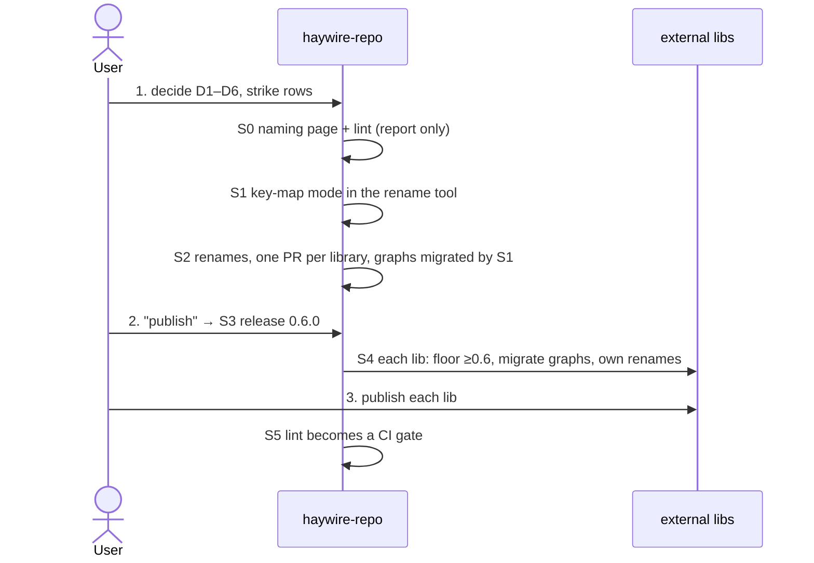

# Component naming scheme: review and rename plan

Date: 2026-11-21 · Status: decided — D1 A, D2 A, D3 A, D4 A, D5 A, D6 B(b), D7 A (revised: `DEPTH_BUFFER`), D8 A, D9 B

## 1. What was reviewed

Every class registered with `@node`, `@type`/`@type_decorator` or `@widget`,
found by an AST scan of six repos (tests, venvs and baked docs excluded):

| Repo | Nodes | Types | Widgets |
|---|---:|---:|---:|
| haywire-repo (builtin + 12 barn libs) | 101 | 56 | 28 |
| haybale-visiongraph | 9 | 6 | 0 |
| haybale-spandrel | 4 | 3 | 0 |
| haybale-protokol | 4 | 0 | 1 |
| haybale-stream | 5 | 0 | 0 |
| haybale-comfyui | 1 | 0 | 0 |
| **Total** | **124** | **65** | **29** |

Adapters (14) follow `<From>To<To>Adapter` already and are out of scope.

### What a rename breaks

- A registry key is `<dist>:<kind>:<ClassName>`, so renaming a class
  changes its key, and every saved graph stores keys (`registry_key`,
  `widget_key`, `chain_adapter_keys`). On load, the graph loader reads **only
  the key**. `class_name`, `registry_id` and `module` in a saved port or
  identity get written at decoration time and never read back, so rewriting
  them is cosmetic.
- No alias or migration table exists for keys. The node canon says "avoid
  renaming the node class", and this plan is the one-time exception.
- Graphs that hold affected keys: 37 in haywire-repo, 4 visiongraph, 3 stream,
  2 spandrel, 2 comfyui, 1 protokol. `BeginPlayNode` alone shows up in all six
  repos.

### Plain string replacement is unsafe

Several old names are substrings of other names or of common words:

- `IMAGE_RGB` ⊂ `IMAGE_RGBA`
- `BeginPlayNode` ⊂ `TestBeginPlayNode`
- `SettingsNode` and `Temperature` also occur in prose and in unrelated code.
- Node ids such as `BeginPlayNode_ea80758b` contain the class name. `\b`
  doesn't split at `_`, so a word-boundary replace misses them. That's
  harmless, since ids are opaque, but it shows that a regex isn't a reliable
  tool for this.

The graph side therefore uses an exact, key-level rewriter (§4 S1).
`haywire rename` already does this per library
(`packages/haywire-studio/src/haywire_studio/packaging/rename/graphs.py`),
so the work is extending that rewriter, not building a new one.

## 2. Proposed scheme

The principle: **one name per component, and the name ends with what the
thing is.** Most of the codebase already follows this. About 90 % of node
classes are their label in CapWords plus `Node`.

### N — nodes

| Rule | Form | Conforming examples |
|---|---|---|
| N1 | Class = label in CapWords + `Node`. Either can change, but they change together | `LoadImageNode` / "Load Image" |
| N2 | One-shot operation (DATA/CONTROL): **verb first** | `SplitPathNode`, `SendFrameNode`, `UpscaleImageNode` |
| N3 | Stateful device or source: **agent noun** | `AudioMixerNode`, `RecorderNode`, `TrackerNode`, `WebCameraNode` |
| N4 | Inspector: `<Thing>Info` | `ImageInfoNode`, `MetadataInfoNode` |
| N5 | EVENT node: `<Trigger>Event` | `TickEventNode`, `AudioEventNode`, `ImageEventNode` |
| N6 | Emitter that feeds event nodes: `<What>Emit` | `TickEmitNode`, `ReceiveFrameEmitNode` |
| N7 | Abstract base: `Base<X>Node` | `BaseEstimatorNode` |
| N8 | No implementation detail (`Numpy`) or library name, unless it tells two palette entries apart | `LoadSpandrelModelNode` keeps "Spandrel" |
| N9 | haybale-testing: `<X>ProbeNode`, benchmarks `Bench<X>Node`, never a `Test` prefix (pytest collects `Test*` classes, and test modules import 40+ of them) | `FoldProbeNode`, `BenchSinkNode` |
| N10 | Node template (`@node(template=True)`, hidden, cloned and never placed): `<Kind>NodeTemplate`, label = the template kind | `DataNodeTemplate` / "Data Node" |

### T — data types

| Rule | Form | Conforming examples |
|---|---|---|
| T1 | Every registered type is `SCREAMING_SNAKE`, generics included. CapWords + `Type` is reserved for unregistered base classes (`PrimitiveType`, `CompoundType`, `WrapperType`) | `OPTIONAL[T]`, `DRAIN[T]` |
| T2 | Compound names put the **head noun last** (see D1) | `FILE_PATH`, `DETECTION_RESULT`, `IMAGE_MODEL` |
| T3 | A family root is the bare noun, with no `_BASE` | `IMAGE`, `PATH`, `CARRIER` |
| T4 | Wire-role types follow T2: `<NAME>_CALLBACK`, `<NAME>_EXEC`. The bare `CALLBACK`/`EXEC` stay core's | (new rule; replaces the glossary's `CALLBACK_<NAME>`) |
| T5 | Short code names are fine. The label spells them out | `INT` / "Integer", `VEC3F` |

### W — widgets

| Rule | Form | Conforming examples |
|---|---|---|
| W1 | Generic control: `<Control>Widget`, in the words users see on the matching widget node (Toggle, Menu, Slider) | `SliderWidget`, `MenuWidget`, `ToggleWidget` |
| W2 | Editor tied to one type: `<Type in CapWords>Widget` | `PathWidget`, `ColorWidget`, `ModelRefWidget` |
| W3 | No vague qualifiers ("Simple") or abbreviations the type doesn't use | `MatrixWidget` |
| W4 | The constant in `widget_keys.py` is the class in SCREAMING_SNAKE | `PATH_WIDGET` |

### Across all kinds

| Rule | |
|---|---|
| X1 | Acronyms in CapWords are written as a word: `Midi`, `Osc`, `Rgb`. Brand names keep their spelling: `ComfyUI`, `OakD` (D2). This matches `ImageToRgbAdapter` and `MidiSendNode` |
| X2 | Labels: Title Case, never the word "Node" (D3) |
| X3 | A module file is renamed only together with its class, and follows the majority in its folder (`nodes/merge_channels.py`, `widgets/label_widget.py`). No file-only renames |

## 3. Renames

Counts are approximate occurrences: `py` = non-test source, `test`, `graph` =
`.haywire`/`.hwm`, `docs` = `.md`. Strike any row you disagree with.

### haywire-core builtin

| Old | New | Rule | py | test | graph | docs |
|---|---|---|---:|---:|---:|---:|
| `MetadataNodeBase` | `BaseMetadataNode` | N7 | 3 | 2 | 0 | 0 |
| `SimpleLabelWidget` | `LabelWidget` | W3 | 43 | 9 | 33 | 9 |
| `VecWidget` | `VectorWidget` | W3 | 14 | 7 | 0 | 16 |
| `NoteTextWidget` | `AnnotationTextWidget` | W3 (shows an Annotation node's text; `ANNOTATION` is the link type, so not `AnnotationWidget`) | 6 | 16 | 0 | 8 |
| `SwitchWidget` / `SWITCH_WIDGET` | `ToggleWidget` / `TOGGLE_WIDGET` | D6 (matches `ToggleNode`) | 18 | 8 | 19 | 10 |
| `SelectWidget` / `SELECT_WIDGET` | `MenuWidget` / `MENU_WIDGET` | D6 (matches `MenuNode`) | 69 | 45 | 40 | 34 |
| `ErrorNode` label "Core Error Node" | label "Error" | X2 | – | – | – | – |

`GraphNode` (label "Group") stays. It is the documented Graph-node base that
`MacroNode` extends, and splitting out a `GroupNode` is an architecture change,
not a rename. It is an accepted exception to N1, recorded on the naming page;
the check reports it until S5's allow-list. `DataNodeTemplate` stays too: it
conforms to N10, and the check skips templates.

### haybale-core

| Old | New | Rule | py | test | graph | docs |
|---|---|---|---:|---:|---:|---:|
| `BeginPlayNode` ("Begin Player") | `BeginPlayEventNode` ("Begin Play Event") | N5, label typo | 12 | 25 | 100 | 3 |
| `ShutdownNode` | `ShutdownEventNode` | N5 | 5 | 12 | 44 | 2 |
| `TickEventNode` label "Tick" | label "Tick Event" | N1 | – | – | – | – |
| `ControlSwitch` | `ControlSwitchNode` | N1 | 10 | 1 | 8 | 2 |
| `WidgetNode` (unregistered base of the widget nodes) | `BaseWidgetNode` | N7 | – | – | 0 | – |
| `ArrayType` | `ARRAY` | T1 | 109 | 37 | 114 | 80 |
| `PooledType` | `POOLED` | T1 | 63 | 28 | 146 | 60 |

### haybale-audio

| Old | New | Rule | py | test | graph | docs |
|---|---|---|---:|---:|---:|---:|
| `ChannelMergeNode` | `MergeChannelsNode` | N2 | 1 | 4 | 0 | 2 |
| `ChannelSelectNode` | `SelectChannelNode` | N2 | 1 | 2 | 0 | 2 |
| `ChannelSplitNode` | `SplitChannelsNode` | N2 | 1 | 2 | 0 | 2 |
| `CALLBACK_AUDIO` | `AUDIO_CALLBACK` | T4 | 24 | 4 | 30 | 9 |
| `EXEC_AUDIO` | `AUDIO_EXEC` | T4 | 27 | 30 | 36 | 20 |

### haybale-image

| Old | New | Rule | py | test | graph | docs |
|---|---|---|---:|---:|---:|---:|
| `IMAGE_GRAY` | `GRAY_IMAGE` | T2 | 8 | 9 | 8 | 5 |
| `IMAGE_RGB` | `RGB_IMAGE` | T2 | 15 | 34 | 84 | 12 |
| `IMAGE_RGBA` | `RGBA_IMAGE` | T2 | 6 | 7 | 2 | 8 |
| `CALLBACK_IMAGE` | `IMAGE_CALLBACK` | T4 | 13 | 3 | 29 | 7 |

| `DEPTH` | `DEPTH_BUFFER` ("Depth Buffer") | T2; the glossary calls the raw millimetre data the depth buffer, and a depth map its colourized view | 4 | 12 | 0 | 5 |

Labels change to "Gray Image", "RGB Image", "RGBA Image", "Image Callback" (X2).

### Data types: full verdict (65)

| Verdict | Types |
|---|---|
| Conform, keep | `INT` `FLOAT` `STRING` `BOOL` `BYTES` `DICT` `COLOR` `PATH` `FILE_PATH` `FOLDER_PATH` `VEC2I`…`VEC4F` `MAT3` `MAT4` `EXEC` `CALLBACK` `CARRIER` `BUNDLE` `IMAGE` `CHOICES` `FIELD_LIST` `FOLD` `ADD` `PROGRESS` `ANNOTATION` `OPTIONAL` `DRAIN` `AUDIO` `MODEL_REF` `FILL` `VISION_RESULT` `DETECTION_RESULT` `SEGMENTATION_RESULT` `LANDMARK_RESULT` `POSE_RESULT` `IMAGE_MODEL` `INPAINT_MODEL` `TEST_*` |
| Rename: case (T1) | `ArrayType` `PooledType` `MapsStringType` `MathOPSelector` `Temperature` `TestData` |
| Rename: order (T2/T4) | `IMAGE_GRAY` `IMAGE_RGB` `IMAGE_RGBA` `CALLBACK_IMAGE` `CALLBACK_AUDIO` `CALLBACK_MULTIFRAME` `EXEC_AUDIO` |
| Rename: base (T3) | `MODEL_BASE` |
| Rename (D7) | `DEPTH` → `DEPTH_BUFFER` |
| Label only (D8) | `LIST` → label "Untyped List", docstring says how it differs from `ARRAY` |
| Label only (D3) | "File path", "Folder path", "Field list", "Image model", "Inpainting model", "Gray/RGB/RGBA image"; vague docstrings on `BYTES`, `LIST`, `DICT`, `FOLD` ("Fold data type") |

The glossary's `RGB_FRAME`/`DEPTH_FRAME`/`GRAY_FRAME` entry names types that no longer exist; S0 removes it.

### haybale-example, haybale-TEST_A

| Old | New | Rule | py | test | graph | docs |
|---|---|---|---:|---:|---:|---:|
| `MathOP` | `MathOperationNode` | N1, X1 | 10 | 15 | 8 | 13 |
| `MathOPSelector` | `MATH_OPERATION` | T1 | 5 | 0 | 8 | 9 |
| `MapsStringType` (label "Array", wrong) | `STRING_MAP` ("String Map") | T1, T2 | 16 | 2 | 0 | 22 |
| `Temperature` | `TEMPERATURE` | T1 | ~41 | 1 | 10 | ~45 |
| `CustomCallbackNode` | `CallbackEventNode` | N5 | 3 | 5 | 0 | 5 |
| `EmitCallbackNode` | `CallbackEmitNode` | N6 | 3 | 2 | 0 | 5 |
| `MergeCallbackNode` | `MergedCallbackEventNode` | N5 | 3 | 0 | 0 | 2 |
| `TestData` (TEST_A) | `TEST_DATA` | T1 | 7 | 0 | 0 | 2 |

### haybale-testing (D4)

Every `Test…Node` and `…TestNode` becomes `…ProbeNode`. The odd names get the
same treatment: `PerformanceTester` → `PerformanceProbeNode`, `SettingsNode` →
`SettingsProbeNode`, `DisplayNode` → `DisplayProbeNode`, the fold and size-box
nodes → `…ProbeNode`. That's 20 classes and about 700 test references, mostly
`TestAddFloatNode` (148), `TestPrintNode` (99) and `SettingsNode` (93).
`PerformanceTester` sits in 4 908 places across the perf graphs, where only
the key rewriter can reach it. `TEST_*` types keep their names, because they
mirror the builtins on purpose.

### External libraries

| Lib | Old | New | Rule | graph refs |
|---|---|---|---|---:|
| visiongraph | `NumpyFrameEventNode` | `FrameEventNode` | N8 | 12 |
| visiongraph | `FrameDisplayNode` ("Frame Info Display") | `ViewFrameNode` ("View Frame"), matching `ViewImageNode` | N1, N2 | 32 |
| visiongraph | `AnnotateNode` ("Annotate Results") | `AnnotateResultsNode` | N1 | 8 |
| visiongraph | `SegmentationNode` | `SegmenterNode`, matching `ObjectDetector`/`PoseEstimator` | N3 | 8 |
| visiongraph | `CALLBACK_MULTIFRAME` | `MULTIFRAME_CALLBACK` | T4 | 10 |
| spandrel | `MODEL_BASE` ("Loaded model") | `LOADED_MODEL` | T3 | 0 |
| spandrel | `LoadModelNode` ("Load Spandrel Model") | `LoadSpandrelModelNode` | N1 | 16 |
| spandrel | `ModelInfoNode` ("Spandrel Model Info") | `SpandrelModelInfoNode` | N1 | 0 |
| protokol | `MidiReceiveNode` (EVENT) | `MidiEventNode` ("MIDI Event") | N5 | 0 |
| protokol | `MidiSendNode` | `SendMidiNode` ("Send MIDI") | N2 | 0 |
| protokol | `OscReceiveNode` (EVENT) | `OscEventNode` ("OSC Event") | N5 | 0 |
| protokol | `OscSendNode` | `SendOscNode` ("Send OSC") | N2 | 0 |
| protokol | `GateSelectWidget` | `GateMenuWidget` | D6 vocabulary | 0 |

Stream and comfyui need no renames of their own. They still take the core
renames (`BeginPlayNode`, `ARRAY`/`POOLED`, the image and audio types).

### Label-only fixes (not breaking)

Bring type labels to Title Case: "File path", "Folder path", "Field list",
"Image model", "Inpainting model", "Loaded model" and "Gray/RGB/RGBA image".
Testing node labels drop the word "Node" ("Bench Bare Node", "Add Port
TestNode", "Settings Test Node").

### Noticed, out of scope

- The widget-node menus put each node in its own submenu
  (`core/widgets/float_number`, `core/widgets/int_slider`, …), which looks
  like a bug.
- Menu roots disagree: `models` vs `image/models`, `examples` vs the
  library name `example`.
- Menu paths aren't saved in graphs, so these can be fixed at any time.

## 4. Plan

| Slice | Content | Done when |
|---|---|---|
| **S0** | `docs/reference/component-naming.md` holds §2, linked from the node, datatype and widget canons and from the haybale canon. The glossary's `CALLBACK_<NAME>` rule and the `_FRAME` note get updated. A naming check is added to `haywire docs`' coverage report, so every library, external ones included, sees violations | `haywire docs --all` lists exactly the rows in §3 |
| **S1** | The rename package gains a key-map mode, `haywire rename --map <file>`. The file lists `[[rename]] old="lib:kind:Name" new="lib:kind:Name"` entries. It matches exact keys in `KEY_FIELDS`/`LIST_KEY_FIELDS`, rewrites `class_name`/`registry_id`/`module` alongside for tidiness, and uses the same discovery, dry run and drift report as today. The map for this release ships in haywire-core, so external libraries can apply it | It migrates a copy of every repo graph, and `haywire verify` passes |
| **S2** | One PR per library: builtin, haybale-core, audio, image, example + TEST_A, testing. Each PR renames the class and its module, the `widget_keys` constant and the label, then runs `/check-rename`, migrates graphs with S1, runs `haywire docs --all` and the docs bake, then `haywire verify`. A renamed `haywire.api` name is removed outright, with no `_DEPRECATED` entry (D9); the barn-lib PRs add no shims either. Each PR adds its own map file to `haywire/core/renames/0.6/` | CI green, `verify` clean |
| **S3** | `/haywire-release` with a minor bump to 0.6.0, and release notes that list the map. Before it: graphs saved before 0.6 migrate on load via graph format v6, which applies the bundled 0.6 maps (decided 2026-11-22, option A) | Tag published |
| **S4** | visiongraph, spandrel, protokol, stream, comfyui: raise `haywire-core>=0.6`, run `haywire rename --map` (the core map plus the lib's own), apply the lib's own renames from §3, regenerate docs, publish. Libraries ship no rename map of their own (decided 2026-11-21): their graphs are migrated once with the core map plus a throwaway entry list; nothing ships. The core map's keys also migrate on load (format v6, see S3); only the lib's own renames need the CLI. | Each lib's `verify` and CI green |
| **S5** | The naming check fails CI for in-repo libs, with an allow-list for accepted exceptions (`GraphNode`). For external libs it stays a coverage line | – |

No runtime key aliases. Per your call, graphs get migrated once; for the
0.6 maps that migration is graph format v6, at load (S3).

## 5. Decisions (settled 2026-11-21)

| | Decision | Choice |
|---|---|---|
| D1 | Order inside compound type names | **A** head noun last (`RGB_IMAGE`, `AUDIO_CALLBACK`) |
| D2 | Acronyms in CapWords | **A** written as a word (`SendMidiNode`); brands keep their spelling |
| D3 | Label casing | **A** Title Case everywhere, types included |
| D4 | haybale-testing renames | **A** included, as their own PR |
| D5 | Migration tool | **A** `haywire rename --map <file>` reuses the rename package's graph walker; the map ships in haywire-core |
| D6 | Widget-node vocabulary | **B(b)** widgets follow the nodes: `SwitchWidget`→`ToggleWidget`, `SelectWidget`→`MenuWidget`, `GateSelectWidget`→`GateMenuWidget` |
| D7 | `DEPTH` | **A, revised** → `DEPTH_BUFFER` ("Depth Buffer"), which keeps the glossary's depth map/buffer entry true. S2 also changes that entry's `DEPTH` mention to `DEPTH_BUFFER` |
| D8 | `LIST` beside `ARRAY` | **A** keep both; `LIST` labelled "Untyped List" |
| D9 | Renamed Author API names (`haywire.api`) | **B** the 0.6 naming release removes old author-API names without a deprecation window, a one-time exception to [ADR 0085](../../docs/adr/0085-a-name-leaves-the-author-api-through-a-deprecation-window.md); external libraries update in S4 before they run on 0.6 |
